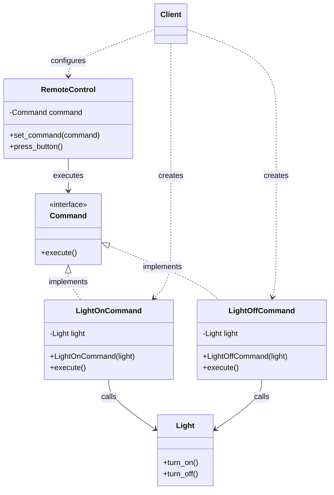


# Command Pattern — Low-Level Design Notes

## 1. What Is the Command Pattern?

The **Command Pattern** is a behavioral design pattern that encapsulates a request as an object.

Instead of calling a method directly, we create a command object that represents the action to perform. The command object can then be passed around, stored, queued, logged, or executed later.

**Definition:** Convert a request into a standalone object containing all the information needed to perform that request.

### Real-World Examples

- **TV Remote:** Each button represents a command, such as turning the TV on or increasing the volume.
- **Text Editor:** Undo and redo operations can be represented as commands.
- **Task Queue:** Tasks can be stored as command objects and executed later.
- **Restaurant:** A food order is recorded as a request and passed to the kitchen for execution.

---

## 2. The Problem Without the Command Pattern

Imagine a remote control that directly calls methods on different devices.

```python
class Light:
    def turn_on(self):
        print("Light is ON")

class Fan:
    def turn_on(self):
        print("Fan is ON")

class Remote:
    def press_light_button(self):
        light = Light()
        light.turn_on()

    def press_fan_button(self):
        fan = Fan()
        fan.turn_on()
```

### Problems

- The remote is tightly coupled to specific devices.
- Adding a new device requires modifying the remote.
- Requests cannot easily be stored, queued, logged, or undone.
- The remote directly manages how actions are performed.

**Solution:** Encapsulate each action inside a command object and let the remote execute that command without knowing the implementation details.

---

## 3. Structure and Components

The Command Pattern typically contains five components.

### 1. Command Interface
Declares the method used to execute a command, usually `execute()`.

### 2. Concrete Command
Implements the command interface and connects a request to the appropriate receiver.

### 3. Receiver
The object that performs the actual work.

Examples: `Light`, `Fan`, `TV`, or `TextEditor`.

### 4. Invoker
Triggers the command without knowing how the action is performed.

Examples: `RemoteControl`, `Button`, or `TaskScheduler`.

### 5. Client
Creates the receiver, concrete command, and invoker, then connects them together.

---

## UML Class Diagram — Command Pattern



### Relationship Summary

- `LightOnCommand` implements `Command`.
- `LightOnCommand` contains a reference to `Light`.
- `RemoteControl` contains a reference to `Command`.
- The client configures the objects.
- The invoker does not need to know which concrete command it executes.

---

## 5. Python Implementation

### Step 1: Create the Receiver

The receiver contains the actual business logic.

```python
class Light:
    def turn_on(self):
        print("Light is ON")

    def turn_off(self):
        print("Light is OFF")
```

### Step 2: Create the Command Interface

```python
from abc import ABC, abstractmethod

class Command(ABC):
    @abstractmethod
    def execute(self):
        pass
```

### Step 3: Create Concrete Commands

Each concrete command encapsulates a specific action.

```python
class LightOnCommand(Command):
    def __init__(self, light):
        self.light = light

    def execute(self):
        self.light.turn_on()


class LightOffCommand(Command):
    def __init__(self, light):
        self.light = light

    def execute(self):
        self.light.turn_off()
```

### Step 4: Create the Invoker

The invoker triggers the command without knowing its implementation.

```python
class RemoteControl:
    def __init__(self):
        self.command = None

    def set_command(self, command):
        self.command = command

    def press_button(self):
        if self.command is not None:
            self.command.execute()
```

### Step 5: Connect Everything in the Client

```python
light = Light()

light_on = LightOnCommand(light)
light_off = LightOffCommand(light)

remote = RemoteControl()

remote.set_command(light_on)
remote.press_button()
# Light is ON

remote.set_command(light_off)
remote.press_button()
# Light is OFF
```

### Execution Flow

1. The client creates a `Light`.
2. The client creates a command and passes the light to it.
3. The client assigns the command to the remote.
4. The user presses the button.
5. The remote calls `execute()`.
6. The command calls the appropriate method on the receiver.

**Key idea:** The invoker knows only the command interface, not the receiver's implementation.

---

## 6. Adding More Commands

One major benefit is that new actions can be introduced without modifying the invoker.

```python
class Fan:
    def turn_on(self):
        print("Fan is ON")

    def turn_off(self):
        print("Fan is OFF")


class FanOnCommand(Command):
    def __init__(self, fan):
        self.fan = fan

    def execute(self):
        self.fan.turn_on()


class FanOffCommand(Command):
    def __init__(self, fan):
        self.fan = fan

    def execute(self):
        self.fan.turn_off()
```

Usage:

```python
fan = Fan()
fan_on = FanOnCommand(fan)

remote.set_command(fan_on)
remote.press_button()
# Fan is ON
```

The same `RemoteControl` can operate lights, fans, TVs, and other devices through the shared `Command` interface.

---

## 7. Important Features of the Command Pattern

### A. Undo Operations

A command can store enough information to reverse an action.

For example, `LightOnCommand` can implement an `undo()` method that turns the light off.

```python
class LightOnCommand(Command):
    def __init__(self, light):
        self.light = light

    def execute(self):
        self.light.turn_on()

    def undo(self):
        self.light.turn_off()
```

A more complex command may need to save the receiver's previous state so that undo restores the exact original state.

### B. Command History

Commands can be stored in a list or stack.

```python
history = []

command = LightOnCommand(light)
command.execute()

history.append(command)
```

A command history can support auditing, replay, or undo, depending on what information each command stores.

### C. Queueing and Scheduling

Commands can be placed in a queue and executed later.

Examples:
- Sending emails in the background.
- Processing payment requests.
- Scheduling jobs.
- Running deferred tasks.

### D. Macro Commands

A macro command combines multiple commands into one operation.

```python
class MacroCommand(Command):
    def __init__(self, commands):
        self.commands = commands

    def execute(self):
        for command in self.commands:
            command.execute()
```

Usage:

```python
macro = MacroCommand([
    LightOnCommand(light),
    FanOnCommand(fan)
])

macro.execute()
```

This turns on both the light and the fan with one command.

---

## 8. When Should You Use the Command Pattern?

Use it when:

- You want to decouple the object that requests an action from the object that performs it.
- You need to queue or schedule requests.
- You need command history, logging, or replay.
- You want to support undo and redo.
- You need to combine multiple actions into a single operation.
- You want to parameterize objects with different actions.

### Common Applications

| Application | Command Pattern Usage |
|---|---|
| TV remote | Buttons represent device actions |
| Text editor | Undo and redo |
| Task scheduler | Store and execute tasks |
| E-commerce | Encapsulate operations such as order processing |
| Smart home | Control different devices uniformly |
| Game development | Represent player input as commands |
| Job queue | Execute requests asynchronously |

---

## 9. Advantages

1. **Loose Coupling:** The invoker does not depend on concrete receivers.
2. **Open/Closed Principle:** New commands can be added without changing the invoker.
3. **Undo/Redo:** Commands can store the information needed to reverse actions.
4. **Queueing:** Requests can be stored and executed later.
5. **Logging and Auditing:** Executed commands can be recorded.
6. **Composition:** Multiple commands can be combined into a macro.
7. **Flexible Execution:** Requests can be passed between different objects.

## 10. Disadvantages

1. **More Classes:** Each action may require a separate concrete command.
2. **Added Complexity:** Simple operations may not need this level of abstraction.
3. **Undo Is Not Automatic:** Reversing an action requires additional logic and state management.
4. **State Management:** Commands may need to preserve previous values to undo correctly.

---

## 11. Command Pattern and SOLID Principles

### Single Responsibility Principle (SRP)
Each concrete command represents a specific action, while the receiver handles the actual business operation.

### Open/Closed Principle (OCP)
New commands can be added without modifying the invoker.

### Dependency Inversion Principle (DIP)
The invoker depends on the `Command` abstraction rather than concrete command classes.

### Note
The pattern can support SOLID principles, but the quality of the design still depends on how the classes and responsibilities are defined.

---

## 12. Command Pattern vs Strategy Pattern

Both patterns use interfaces and composition, but they solve different problems.

| Feature | Command Pattern | Strategy Pattern |
|---|---|---|
| Main purpose | Encapsulate a request as an object | Encapsulate interchangeable algorithms |
| Typical method | `execute()` | A domain-specific method such as `pay()` |
| Main focus | Representing and triggering actions | Choosing how a task is performed |
| Undo support | Can be designed into commands | Not a typical responsibility |
| Queueing | A common use case | Not a typical use case |
| Example | Remote button action | Choosing a payment method |

**Example:**
- Command: `TurnOnLightCommand`
- Strategy: `CreditCardPayment` or `UPIPayment`

---

## 13. Command Pattern vs Observer Pattern

| Feature | Command Pattern | Observer Pattern |
|---|---|---|
| Purpose | Encapsulate an action or request | Notify interested objects about an event |
| Direction | Invoker triggers a command | Subject notifies subscribers |
| Key method | `execute()` | `update()` or a similar notification method |
| Example | Pressing a save button | Notifying the UI that data changed |

**Remember:**
- Command = *Do this.*
- Observer = *Something happened; notify interested objects.*

---

## 14. Command Pattern vs Memento Pattern

| Feature | Command Pattern | Memento Pattern |
|---|---|---|
| Purpose | Encapsulate an operation | Capture and restore an object's state |
| Main concern | Actions and requests | State snapshots |
| Typical use | Execute, queue, or undo actions | Undo by restoring a previous state |
| Example | `DeleteTextCommand` | A snapshot of the document before deletion |

These patterns can work together: a command may use a memento to preserve the state needed for undo.

---

## 15. Common Mistakes

- Putting all business logic inside the invoker instead of the receiver.
- Making the invoker depend directly on concrete command classes.
- Creating command objects without a genuine need for decoupling or request management.
- Assuming every command can be undone automatically.
- Forgetting to store the previous state when undo requires it.
- Confusing a command (an action request) with a strategy (an interchangeable algorithm).

---

## 16. Interview Questions

### Beginner
1. What is the Command Pattern?
2. Why is it categorized as a behavioral design pattern?
3. What are the five main components?
4. What is the difference between a command and a receiver?
5. What role does the invoker play?

### Intermediate
6. How does the Command Pattern reduce coupling?
7. How can it support undo and redo?
8. How would you implement a macro command?
9. How can commands be queued or scheduled?
10. How does the Command Pattern support the Open/Closed Principle?

### Advanced
11. How would you design command history for a text editor?
12. How would you handle failed or partially completed commands?
13. How can commands be made safe to retry?
14. What is the difference between an in-memory command and a durable job stored in a queue?
15. When would the Command Pattern be unnecessary?

---

## 17. Practice Exercises

### Exercise 1: Remote Control
Implement commands for:
- Light ON/OFF
- Fan ON/OFF
- TV ON/OFF

Use a single remote-control invoker.

### Exercise 2: Text Editor
Implement:
- `WriteCommand`
- `DeleteCommand`
- `UndoCommand`

Store command history and restore the document when undo is requested.

### Exercise 3: Shopping Cart
Create commands for:
- Add item
- Remove item
- Apply discount

Consider which operations can be safely reversed.

### Exercise 4: Game Input
Create commands such as:
- `MoveForwardCommand`
- `JumpCommand`
- `AttackCommand`

Allow the input handler to map different keys to different commands.

### Exercise 5: Task Scheduler
Create a command queue that stores tasks and executes them in order.

---

## 18. Quick Revision

- **Pattern category:** Behavioral
- **Intent:** Encapsulate a request as an object.
- **Main components:** Client, Command, Concrete Command, Receiver, Invoker.
- **Core method:** `execute()`
- **Main benefit:** Decouples the requester from the object performing the work.
- **Common applications:** Remote controls, undo/redo, task queues, scheduled jobs, and macro operations.
- **Related patterns:** Strategy, Observer, and Memento.

### One-Line Summary

The Command Pattern turns an action into an object so that the action can be executed, passed around, queued, logged, combined, or potentially undone without tightly coupling the requester to the receiver.
# Command Pattern
