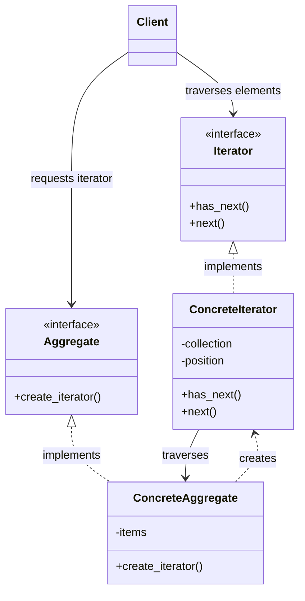


# Iterator Pattern — Low-Level Design Notes

## 1. What Is the Iterator Pattern?

The **Iterator Pattern** is a behavioral design pattern that provides a standard way to access elements of a collection sequentially without exposing the collection's internal representation.

It allows clients to traverse different collections using a consistent interface, regardless of how those collections store their elements.

### Real-World Examples

- **Playlist:** Move from one song to the next without knowing how songs are stored.
- **Book:** Read pages one by one without knowing the book's internal structure.
- **Shopping Cart:** Iterate through products in the cart.
- **File System:** Traverse files and directories.
- **Database Results:** Process query results one record at a time.

### Key Idea

**Access elements one by one without exposing the internal structure of the collection.**

---

## 2. The Problem Without the Iterator Pattern

Imagine that different collections store their elements differently.

```python
class BookCollection:
    def __init__(self):
        self.books = ["Python", "Java", "C++"]


class Playlist:
    def __init__(self):
        self.songs = ("Song A", "Song B", "Song C")
```

A client must know whether to access `books`, `songs`, a list, a tuple, or some other internal structure.

### Problems

- The client depends on the collection's internal representation.
- Different collections may require different traversal logic.
- Changing the internal data structure can break client code.
- Traversal logic may be duplicated across multiple clients.

**Solution:** Introduce an iterator that provides a common interface for traversing a collection.

---

## 3. Structure and Components

### 1. Iterator Interface

Defines the operations used to traverse elements.

Common operations include:

- `__iter__()` — Returns an iterator.
- `__next__()` — Returns the next element.
- `has_next()` — Checks whether another element exists; common in custom iterators in languages such as Java.

The exact interface depends on the programming language.

### 2. Concrete Iterator

Implements the traversal logic and maintains the current position.

Responsibilities:
- Track the current element.
- Return the next element.
- Determine when iteration is complete.

### 3. Aggregate Interface

Defines an interface for a collection that can provide an iterator.

### 4. Concrete Aggregate

Stores the elements and creates an iterator for traversing them.

### 5. Client

Uses the iterator to access elements without depending on the collection's internal structure.

---

## 4. UML Class Diagram



### Relationship Summary

- `ConcreteIterator` implements the iterator interface.
- `ConcreteAggregate` implements the aggregate interface.
- The concrete aggregate creates an iterator.
- The iterator traverses the collection.
- The client uses the iterator instead of directly accessing the collection's internal data.

---

## 5. Python Implementation

Python already supports iteration through the iterator protocol. The following example implements a custom iterator to demonstrate the design pattern explicitly.

### Step 1: Create the Iterator

```python
class BookIterator:
    def __init__(self, books):
        self.books = books
        self.position = 0

    def __iter__(self):
        return self

    def __next__(self):
        if self.position >= len(self.books):
            raise StopIteration

        book = self.books[self.position]
        self.position += 1
        return book
```

### Step 2: Create the Collection

```python
class BookCollection:
    def __init__(self):
        self.books = []

    def add_book(self, book):
        self.books.append(book)

    def __iter__(self):
        return BookIterator(self.books)
```

### Step 3: Use the Iterator

```python
collection = BookCollection()

collection.add_book("Python Basics")
collection.add_book("Clean Code")
collection.add_book("Design Patterns")

for book in collection:
    print(book)
```

### Output

```text
Python Basics
Clean Code
Design Patterns
```

### How It Works

1. The client creates a `BookCollection`.
2. Books are added to the collection.
3. The `for` loop requests an iterator through `__iter__()`.
4. The iterator returns each book through `__next__()`.
5. When no elements remain, `StopIteration` signals the end.

**Important:** Python's `for` loop handles `StopIteration` automatically.

---

## 6. Supporting Multiple Iterators

A collection can create multiple independent iterators, each maintaining its own position.

```python
collection = BookCollection()

collection.add_book("Python")
collection.add_book("Java")
collection.add_book("C++")

iterator1 = iter(collection)
iterator2 = iter(collection)

print(next(iterator1))  # Python
print(next(iterator1))  # Java

print(next(iterator2))  # Python
```

Output:

```text
Python
Java
Python
```

Both iterators traverse the same collection independently because each iterator has its own `position`.

This is useful when multiple consumers need to traverse the same data at different speeds.

---

## 7. Iterator Pattern with Different Collections

The client can traverse different collections using the same interface.

```python
class SongIterator:
    def __init__(self, songs):
        self.songs = songs
        self.position = 0

    def __iter__(self):
        return self

    def __next__(self):
        if self.position >= len(self.songs):
            raise StopIteration

        song = self.songs[self.position]
        self.position += 1
        return song


class Playlist:
    def __init__(self, songs):
        self.songs = songs

    def __iter__(self):
        return SongIterator(self.songs)
```

Usage:

```python
playlist = Playlist([
    "Song A",
    "Song B",
    "Song C"
])

for song in playlist:
    print(song)
```

The client only needs the iteration interface. It does not need to know how the playlist stores its songs.

---

## 8. Types of Iterators

### A. Forward Iterator

Moves through elements in one direction.

Example: Reading songs from the beginning to the end of a playlist.

### B. Bidirectional Iterator

Moves both forward and backward.

Example: Navigating between pages in an application.

### C. Internal Iterator

The collection or iterator controls traversal through a callback or loop abstraction.

Example: Python's `map()` and collection-processing functions.

### D. External Iterator

The client explicitly requests the next element.

Example:

```python
iterator = iter([10, 20, 30])

print(next(iterator))
print(next(iterator))
```

Python's iterator protocol supports external iteration through `iter()` and `next()`.

---

## 9. Advantages

1. **Encapsulation:** Hides the collection's internal structure.
2. **Uniform Traversal:** Provides a consistent way to access elements.
3. **Separation of Concerns:** Separates traversal logic from collection storage.
4. **Multiple Traversals:** Independent iterators can maintain separate positions.
5. **Flexibility:** Different collections can expose a common traversal interface.
6. **Lazy Processing:** Elements can be generated or processed one at a time, potentially reducing memory usage.

## 10. Disadvantages

1. **Additional Classes:** Custom implementations may introduce extra complexity.
2. **State Management:** Iterators must track their traversal position correctly.
3. **Modification Issues:** Changing a collection during iteration can cause unexpected behavior, depending on the implementation.
4. **Limited Access:** A simple forward iterator may not support backward traversal or random access.
5. **Unnecessary Abstraction:** Built-in iteration may already be sufficient for simple collections.

---

## 11. Iterator Pattern and SOLID Principles

### Single Responsibility Principle (SRP)

The collection stores elements, while the iterator manages traversal.

### Open/Closed Principle (OCP)

New collection types and iterator implementations can be introduced without changing existing client traversal logic, provided they follow the expected interface.

### Dependency Inversion Principle (DIP)

Clients can depend on an iterator abstraction rather than concrete collection implementations.

The pattern can support these principles, but the quality of the design depends on its implementation.

---

## 12. Iterator Pattern vs Composite Pattern

| Feature | Iterator Pattern | Composite Pattern |
|---|---|---|
| Category | Behavioral | Structural |
| Purpose | Traverse a collection | Represent part-whole hierarchies |
| Main concern | Accessing elements sequentially | Treating individual objects and groups uniformly |
| Example | Iterate through playlist songs | Represent folders containing files and subfolders |

These patterns can be combined. An iterator can traverse a composite tree of folders and files.

---

## 13. Iterator Pattern vs Strategy Pattern

| Feature | Iterator Pattern | Strategy Pattern |
|---|---|---|
| Purpose | Traverse elements | Select an interchangeable algorithm |
| Main responsibility | Track and return elements | Execute a selected behavior |
| Example | Iterate over products | Choose a payment method |
| Main focus | Collection traversal | Algorithm selection |

Both patterns encapsulate behavior, but they solve different problems.

---

## 14. Iterator Pattern vs Generator in Python

A Python generator is a convenient way to create an iterator without writing a separate iterator class.

### Custom Iterator

```python
class NumberIterator:
    def __init__(self, limit):
        self.limit = limit
        self.current = 0

    def __iter__(self):
        return self

    def __next__(self):
        if self.current >= self.limit:
            raise StopIteration

        self.current += 1
        return self.current
```

### Generator Equivalent

```python
def number_generator(limit):
    current = 1

    while current <= limit:
        yield current
        current += 1


for number in number_generator(3):
    print(number)
```

Output:

```text
1
2
3
```

### Key Difference

- **Custom iterator class:** Explicitly manages iteration state and implements the iterator protocol.
- **Generator:** Uses `yield` to preserve execution state automatically.

A generator is often simpler in Python when a custom collection class and iterator object are unnecessary.

---

## 15. Common Mistakes

- Exposing internal collection details to clients unnecessarily.
- Putting collection storage and all traversal logic into one tightly coupled class.
- Forgetting to signal the end of iteration.
- Sharing traversal position between iterators when independent traversal is expected.
- Assuming an iterator can be reused indefinitely after exhaustion.
- Modifying a collection during traversal without defining the expected behavior.
- Implementing a custom iterator when Python's built-in iteration already solves the problem.

---

## 16. Interview Questions

### Beginner

1. What is the Iterator Pattern?
2. Why is it categorized as a behavioral design pattern?
3. What are the main components?
4. What is the difference between an iterator and an iterable?
5. What do `__iter__()` and `__next__()` do in Python?

### Intermediate

6. How does the Iterator Pattern hide collection internals?
7. How can multiple iterators traverse the same collection independently?
8. What happens when a Python iterator is exhausted?
9. What is the difference between internal and external iteration?
10. How do generators simplify iterator implementation?

### Advanced

11. How would you implement a bidirectional iterator?
12. How would you iterate through a tree structure?
13. What issues can occur if a collection changes during iteration?
14. How can lazy iteration improve memory efficiency?
15. When is a custom iterator unnecessary?

---

## 17. Practice Exercises

### Exercise 1: Book Collection

Create a book collection and a custom iterator that returns books one by one.

### Exercise 2: Playlist Iterator

Implement a playlist iterator that supports forward traversal.

### Exercise 3: Reverse Iterator

Create an iterator that returns elements in reverse order.

### Exercise 4: Tree Iterator

Create a tree data structure and implement a depth-first traversal iterator.

### Exercise 5: Paginated API Iterator

Simulate an API that returns data in pages. Build an iterator that fetches and yields records incrementally.

### Exercise 6: Infinite Iterator

Create a generator or iterator that produces an infinite sequence of integers, stopping only when the client decides to stop.

---

## 18. Quick Revision

- **Pattern category:** Behavioral
- **Intent:** Access collection elements sequentially without exposing internal representation.
- **Main components:** Iterator, Concrete Iterator, Aggregate, Concrete Aggregate, Client.
- **Core operations:** `has_next()` and `next()` in a typical custom design; `__iter__()` and `__next__()` in Python.
- **Main technique:** Encapsulation of traversal logic.
- **Main benefit:** Separates collection storage from traversal.
- **Common applications:** Playlists, file systems, collections, database results, and tree traversal.
- **Related concepts:** Generators, Composite Pattern, and Strategy Pattern.

### One-Line Summary

The Iterator Pattern provides a standard way to traverse a collection one element at a time without exposing how the collection stores its data.
