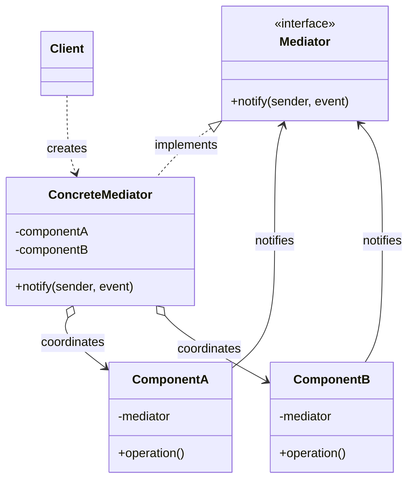
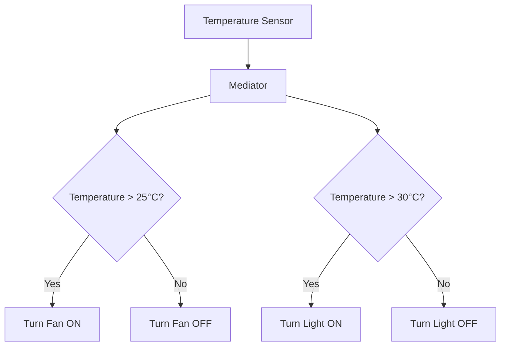
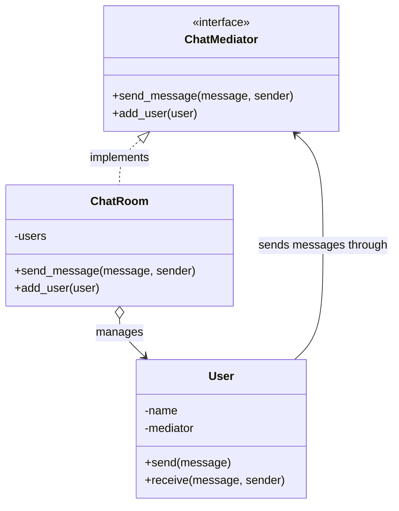


# Mediator Pattern — Low-Level Design Notes

## 1. What Is the Mediator Pattern?

The **Mediator Pattern** is a behavioral design pattern that defines a central object through which multiple objects communicate, reducing direct dependencies between them.

Instead of allowing objects to communicate directly with one another, they communicate through a mediator that coordinates their interactions.

### Real-World Examples

- **Air Traffic Control:** Aircraft communicate through air traffic control to coordinate takeoffs and landings.
- **Chat Room:** Users send messages through a chat room instead of managing direct connections to every other user.
- **Smart Home:** A central controller coordinates lights, fans, sensors, and alarms.
- **GUI Components:** A dialog box coordinates interactions between buttons, text fields, and checkboxes.
- **Online Shopping:** An order coordinator manages interactions between inventory, payment, and shipping services.

### Key Idea

**Centralize communication between related objects so they do not need to know about one another directly.**

---

## 2. The Problem Without the Mediator Pattern

Imagine a smart home with lights, a fan, an alarm, and a temperature sensor.

Without a mediator, every device may need direct references to other devices.

```python
class Light:
    def turn_on(self):
        print("Light ON")


class Fan:
    def turn_on(self):
        print("Fan ON")


class TemperatureSensor:
    def check_temperature(self, light, fan):
        temperature = 30

        if temperature > 25:
            light.turn_on()
            fan.turn_on()
```

### Problems

- Components become tightly coupled.
- Each component needs knowledge of other components.
- Adding a new component can require changes in multiple classes.
- Communication logic becomes scattered throughout the system.
- Testing and maintaining interactions becomes harder.

**Solution:** Introduce a mediator that coordinates communication between components.

---

## 3. Structure and Components

### 1. Mediator Interface

Defines the common interface through which components communicate with the mediator.

Example method:

- `notify(sender, event)`

### 2. Concrete Mediator

Implements the coordination logic between components.

Responsibilities:
- Receive notifications from components.
- Decide which components should respond.
- Coordinate the interactions between components.
- Keep communication rules in one place.

### 3. Colleagues or Components

These are the objects that communicate through the mediator.

Examples:
- Buttons
- Text fields
- Chat users
- Lights and sensors

A component typically knows the mediator but does not need direct references to all the other components.

### 4. Client

Creates the mediator and components, then connects them together.

---

## 4. UML Class Diagram



### Relationship Summary

- `Mediator` defines the communication interface.
- `ConcreteMediator` implements the coordination logic.
- Components hold a reference to the mediator.
- Components notify the mediator when an event occurs.
- The mediator decides how other components should respond.
- The client creates and connects the objects.

---

## 5. Python Implementation — Smart Home

We will create a smart home in which a temperature sensor communicates with a light and fan through a mediator.

### Step 1: Create the Mediator Interface

```python
from abc import ABC, abstractmethod


class Mediator(ABC):

    @abstractmethod
    def notify(self, sender, event):
        pass
```

### Step 2: Create the Base Component

```python
class Component:

    def __init__(self, mediator=None):
        self.mediator = mediator

    def set_mediator(self, mediator):
        self.mediator = mediator
```

Each component holds a reference to the mediator instead of directly managing all other components.

### Step 3: Create the Concrete Components

```python
class Light(Component):

    def turn_on(self):
        print("Light is ON")

    def turn_off(self):
        print("Light is OFF")


class Fan(Component):

    def turn_on(self):
        print("Fan is ON")

    def turn_off(self):
        print("Fan is OFF")


class TemperatureSensor(Component):

    def check_temperature(self, temperature):
        print(f"Temperature: {temperature}°C")

        if self.mediator:
            self.mediator.notify(self, ("temperature", temperature))
```

### Step 4: Create the Concrete Mediator

```python
class SmartHomeMediator(Mediator):

    def __init__(self):
        self.light = Light(self)
        self.fan = Fan(self)
        self.sensor = TemperatureSensor(self)

    def notify(self, sender, event):
        event_type, value = event

        if event_type == "temperature":
            if value > 25:
                self.fan.turn_on()
            else:
                self.fan.turn_off()

            if value > 30:
                self.light.turn_on()
            else:
                self.light.turn_off()
```

### Step 5: Use the Mediator

```python
smart_home = SmartHomeMediator()

smart_home.sensor.check_temperature(28)

print("---")

smart_home.sensor.check_temperature(32)

print("---")

smart_home.sensor.check_temperature(20)
```

### Output

```text
Temperature: 28°C
Fan is ON
Light is OFF
---
Temperature: 32°C
Fan is ON
Light is ON
---
Temperature: 20°C
Fan is OFF
Light is OFF
```

### How It Works

1. The client creates the smart home mediator.
2. The mediator creates the components and connects them.
3. The temperature sensor detects a temperature and notifies the mediator.
4. The mediator evaluates the event.
5. The mediator tells the fan and light what actions to perform.
6. The sensor does not need to know how the fan or light works.

**Important:** The example demonstrates the communication structure. In a production system, the mediator would normally coordinate events and policies without necessarily creating all components itself.

---

## 6. Communication Flow Diagram

The class diagram shows the static structure. This flowchart shows how communication happens at runtime.



### Flow Summary

1. The sensor detects the temperature.
2. The sensor sends an event to the mediator.
3. The mediator evaluates the event.
4. The mediator coordinates the appropriate device actions.

---

## 7. Mediator Pattern in a Chat Room

A chat room is another common example.

Instead of each user sending messages directly to every other user, each user sends a message through the chat room.

### Mermaid Class Diagram



### Python Implementation

```python
class ChatRoom:

    def __init__(self):
        self.users = []

    def add_user(self, user):
        self.users.append(user)

    def send_message(self, message, sender):
        for user in self.users:
            if user is not sender:
                user.receive(message, sender.name)


class User:

    def __init__(self, name, mediator):
        self.name = name
        self.mediator = mediator

    def send(self, message):
        print(f"{self.name} sends: {message}")
        self.mediator.send_message(message, self)

    def receive(self, message, sender):
        print(f"{self.name} receives from {sender}: {message}")
```

### Usage

```python
chat_room = ChatRoom()

alice = User("Alice", chat_room)
bob = User("Bob", chat_room)
charlie = User("Charlie", chat_room)

chat_room.add_user(alice)
chat_room.add_user(bob)
chat_room.add_user(charlie)

alice.send("Hello everyone!")
```

### Output

```text
Alice sends: Hello everyone!
Bob receives from Alice: Hello everyone!
Charlie receives from Alice: Hello everyone!
```

The chat room handles message distribution, so users do not need references to every other user.

---

## 8. When Should You Use the Mediator Pattern?

Use it when:

- Multiple objects communicate with one another.
- Components have too many direct dependencies.
- Communication rules are scattered across many classes.
- You need to centralize coordination logic.
- You want to make components easier to reuse and test independently.

### Common Applications

| Application | Mediator's Responsibility |
|---|---|
| Chat application | Routes messages between users |
| Smart home | Coordinates devices and sensors |
| GUI dialog | Coordinates controls and user interactions |
| Air traffic control | Coordinates aircraft movements |
| Order processing | Coordinates workflow components |
| Multiplayer game | Coordinates player interactions or game events |

---

## 9. Advantages

1. **Reduced Coupling:** Components communicate through a mediator rather than depending directly on one another.
2. **Centralized Coordination:** Interaction rules live in one place.
3. **Improved Reusability:** Components can be reused with a different mediator.
4. **Easier Testing:** Components can be tested independently by substituting a mediator.
5. **Simpler Communication:** Components need fewer direct references to other components.
6. **Maintainability:** Changes to interaction rules can often be made within the mediator.

## 10. Disadvantages

1. **God Object Risk:** A mediator can become too large if it manages too many responsibilities.
2. **Central Dependency:** Many components depend on the mediator's interface.
3. **Complexity:** A mediator may add unnecessary abstraction to a simple system.
4. **Growing Coordination Logic:** Complicated workflows can make the concrete mediator difficult to maintain.
5. **Potential Bottleneck:** In systems with heavy synchronous communication, one mediator may become a performance bottleneck if poorly designed.

---

## 11. Mediator Pattern and SOLID Principles

### Single Responsibility Principle (SRP)

The mediator manages interactions between components, while each component focuses on its own responsibilities.

Avoid making the mediator responsible for unrelated business logic.

### Open/Closed Principle (OCP)

New components can often be introduced by extending the mediator's coordination behavior without changing existing components.

However, adding many new interaction rules may still require modifying the concrete mediator.

### Dependency Inversion Principle (DIP)

Components can depend on the mediator abstraction rather than concrete implementations of other components.

### Important Note

The pattern can support SOLID principles, but it does not guarantee that every implementation follows them.

---

## 12. Mediator Pattern vs Observer Pattern

Both patterns help objects communicate, but they serve different purposes.

| Feature | Mediator Pattern | Observer Pattern |
|---|---|---|
| Main purpose | Coordinate interactions between components | Notify subscribers when an event occurs |
| Communication | Usually routed through a mediator | Usually from subject to observers |
| Coordination logic | Centralized in the mediator | Often distributed among observers and the subject |
| Relationship | Components communicate through the mediator | Observers subscribe to a subject |
| Example | Chat room routes messages between users | YouTube notifies subscribers about a new video |

### Quick Rule

- Use **Mediator** when you need to coordinate interactions between multiple components.
- Use **Observer** when one object needs to notify multiple interested objects about a change.

A mediator can use the Observer Pattern internally to receive events.

---

## 13. Mediator Pattern vs Facade Pattern

Both patterns can provide a central point of interaction, but their intent differs.

| Feature | Mediator Pattern | Facade Pattern |
|---|---|---|
| Category | Behavioral | Structural |
| Purpose | Coordinate communication between components | Simplify access to a subsystem |
| Communication | Components often notify the mediator | Clients call the facade |
| Main focus | Managing interactions | Providing a simplified interface |
| Example | Chat room coordinates users | `OrderService` offers a simplified interface to payment, inventory, and shipping services |

### Quick Rule

- **Mediator:** Coordinates how components interact.
- **Facade:** Simplifies how clients access a complex subsystem.

---

## 14. Mediator Pattern vs Command Pattern

| Feature | Mediator Pattern | Command Pattern |
|---|---|---|
| Purpose | Coordinate communication between components | Encapsulate a request as an object |
| Main component | Concrete mediator | Concrete command |
| Main concern | Relationships and interactions | Representing and executing actions |
| Example | Chat room routes messages | Remote-control command turns on a light |

These patterns can work together. A mediator might create, schedule, or dispatch command objects as part of a workflow.

---

## 15. Common Mistakes

- Making the mediator responsible for every business operation.
- Allowing components to communicate directly when that defeats the intended decoupling.
- Introducing a mediator when components have few interactions and little coupling.
- Hardcoding too many unrelated rules into one concrete mediator.
- Confusing coordination with simple subsystem access.
- Forgetting to define clear responsibilities between the mediator and the components.
- Assuming that centralizing communication automatically eliminates all dependencies.

---

## 16. Interview Questions

### Beginner

1. What is the Mediator Pattern?
2. Why is it a behavioral design pattern?
3. What are the main components?
4. Why do components communicate through a mediator?
5. What is a concrete mediator?

### Intermediate

6. How does the Mediator Pattern reduce coupling?
7. What are the advantages and disadvantages of centralizing communication?
8. How would you implement a chat room using the Mediator Pattern?
9. What is the difference between a mediator and a component?
10. How can the mediator become a God Object?

### Advanced

11. What is the difference between Mediator and Observer?
12. What is the difference between Mediator and Facade?
13. How would you design a mediator for a smart home?
14. How can you prevent the mediator from becoming too complex?
15. Can Mediator and Command be used together?

---

## 17. Practice Exercises

### Exercise 1: Chat Room

Create a chat room where multiple users can send messages through a mediator.

Requirements:
- Add and remove users.
- Broadcast messages to other users.
- Ensure users do not need direct references to one another.

### Exercise 2: Smart Home Controller

Create a mediator for:
- Light
- Fan
- Temperature sensor
- Alarm

Define rules that coordinate devices based on sensor events.

### Exercise 3: GUI Dialog

Create a registration dialog with:
- Username field
- Password field
- Submit button
- Cancel button

Use a mediator to coordinate field validation and button behavior.

### Exercise 4: Order Processing

Create an order mediator that coordinates:
- Inventory
- Payment
- Shipping

Keep each component responsible for its own operations.

### Exercise 5: Multiplayer Game

Create a game mediator that coordinates players entering a lobby and sending game events.

---

## 18. Quick Revision

- **Pattern category:** Behavioral
- **Intent:** Centralize communication and coordination between related objects.
- **Main components:** Mediator interface, concrete mediator, components, and client.
- **Core operation:** A notification method such as `notify(sender, event)`.
- **Main technique:** Composition and delegation.
- **Main benefit:** Reduces direct dependencies between components.
- **Common applications:** Chat rooms, GUI dialogs, smart homes, and coordinated workflows.
- **Related patterns:** Observer, Facade, and Command.

### One-Line Summary

The Mediator Pattern centralizes communication between related objects so they can interact without being tightly coupled to one another.
