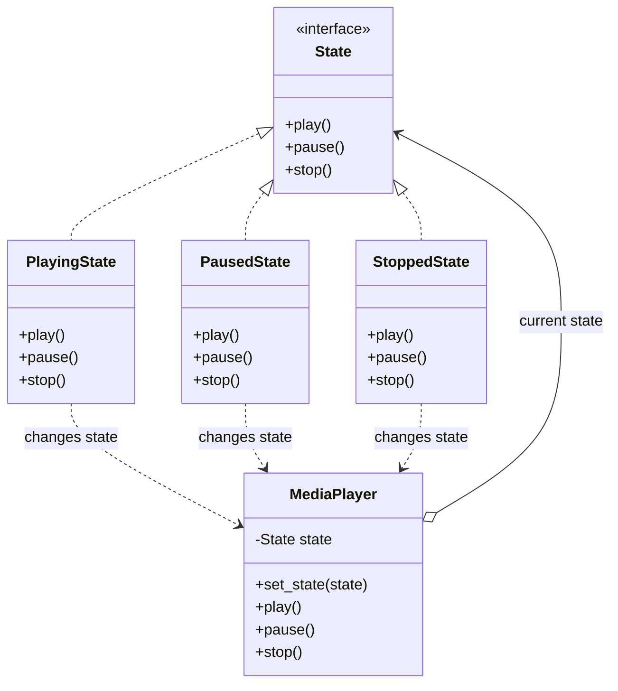
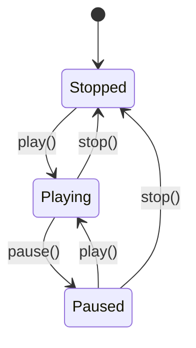


# State Pattern — Low-Level Design Notes

## 1. What Is the State Pattern?

The **State Pattern** is a behavioral design pattern that allows an object to change its behavior when its internal state changes. From the outside, it can appear as though the object has changed its class.

Instead of implementing all state-dependent behavior using large `if-elif-else` or `switch` statements, we encapsulate each state in a separate class.

### Real-World Examples

- **Vending Machine:** Behaves differently when idle, when money is inserted, and when a product is dispensed.
- **Traffic Light:** Switches between red, green, and yellow states.
- **Media Player:** Behaves differently when playing, paused, or stopped.
- **Order Management:** An order behaves differently when pending, paid, shipped, or delivered.
- **Game Character:** A character behaves differently when idle, running, jumping, or attacking.

### Key Idea

**Encapsulate state-specific behavior in separate classes and delegate operations to the current state object.**

---

## 2. The Problem Without the State Pattern

Imagine a media player that manages its behavior using conditional statements.

```python
class MediaPlayer:
    def __init__(self):
        self.state = "stopped"

    def press_button(self):
        if self.state == "stopped":
            self.state = "playing"
            print("Playing media")

        elif self.state == "playing":
            self.state = "paused"
            print("Media paused")

        elif self.state == "paused":
            self.state = "playing"
            print("Resuming media")
```

### Problems

- State-dependent logic accumulates in conditional statements.
- Adding a new state requires modifying existing methods.
- State transitions become difficult to manage as the system grows.
- Different operations may require repeating the same state checks.
- Invalid transitions can accidentally be allowed.

**Solution:** Represent each state as a separate class and let the current state determine how an operation behaves.

---

## 3. Structure and Components

### 1. State Interface

Defines the operations that all concrete states must implement.

Examples:
- `play()`
- `pause()`
- `stop()`

### 2. Concrete State

Implements the behavior associated with a particular state.

Examples:
- `PlayingState`
- `PausedState`
- `StoppedState`

Each state determines what happens when an operation is invoked.

### 3. Context

The main object whose behavior changes depending on its current state.

Responsibilities:
- Store the current state.
- Delegate operations to that state.
- Allow state transitions.

Example: `MediaPlayer`.

### 4. Client

Creates or configures the context and invokes its operations.

The client usually interacts with the context rather than directly managing state-specific behavior.

---

## 4. UML Class Diagram



### Relationship Summary

- `State` defines a common interface.
- Concrete state classes implement state-specific behavior.
- `MediaPlayer` stores a reference to the current state.
- The context delegates operations to its current state.
- State objects can request transitions by updating the context's state.

---

## 5. Python Implementation

We will implement a media player with three states:

1. Stopped
2. Playing
3. Paused

### Step 1: Create the State Interface

```python
from abc import ABC, abstractmethod


class State(ABC):

    @abstractmethod
    def play(self, player):
        pass

    @abstractmethod
    def pause(self, player):
        pass

    @abstractmethod
    def stop(self, player):
        pass
```

Each state must define how the player responds to the three operations.

### Step 2: Create the Context

```python
class MediaPlayer:

    def __init__(self):
        self.state = StoppedState()

    def set_state(self, state):
        self.state = state

    def play(self):
        self.state.play(self)

    def pause(self):
        self.state.pause(self)

    def stop(self):
        self.state.stop(self)
```

The context delegates every operation to its current state.

### Step 3: Implement the Stopped State

```python
class StoppedState(State):

    def play(self, player):
        print("Starting media")
        player.set_state(PlayingState())

    def pause(self, player):
        print("Cannot pause: media is stopped")

    def stop(self, player):
        print("Media is already stopped")
```

### Step 4: Implement the Playing State

```python
class PlayingState(State):

    def play(self, player):
        print("Media is already playing")

    def pause(self, player):
        print("Pausing media")
        player.set_state(PausedState())

    def stop(self, player):
        print("Stopping media")
        player.set_state(StoppedState())
```

### Step 5: Implement the Paused State

```python
class PausedState(State):

    def play(self, player):
        print("Resuming media")
        player.set_state(PlayingState())

    def pause(self, player):
        print("Media is already paused")

    def stop(self, player):
        print("Stopping media")
        player.set_state(StoppedState())
```

### Step 6: Use the State Pattern

```python
player = MediaPlayer()

player.play()
# Starting media

player.pause()
# Pausing media

player.play()
# Resuming media

player.stop()
# Stopping media
```

### Execution Flow

1. The player starts in `StoppedState`.
2. Calling `play()` delegates the request to `StoppedState`.
3. The state starts playback and changes the context to `PlayingState`.
4. Calling `pause()` delegates to `PlayingState`.
5. The player transitions to `PausedState`.
6. Calling `play()` resumes playback and returns to `PlayingState`.
7. Calling `stop()` transitions back to `StoppedState`.

**Important:** The context does not need a large conditional statement to decide what each operation means. The current state object determines the behavior.

---

## 6. State Transition Diagram

The class diagram shows the structure of the pattern. A state transition diagram shows how the object moves between states.



### Understanding the Transitions

| Current State | Operation | Next State |
|---|---|---|
| Stopped | `play()` | Playing |
| Playing | `pause()` | Paused |
| Paused | `play()` | Playing |
| Playing | `stop()` | Stopped |
| Paused | `stop()` | Stopped |

Invalid or redundant operations can be rejected, ignored, or handled with an appropriate message, depending on the requirements.

---

## 7. State Pattern vs Conditional Logic

Without the State Pattern:

```python
def play(self):
    if self.state == "stopped":
        ...
    elif self.state == "paused":
        ...
    elif self.state == "playing":
        ...
```

With the State Pattern:

```python
def play(self):
    self.state.play(self)
```

### Why Is This Better?

- Each state owns its behavior.
- State-specific logic is separated into different classes.
- New states can often be introduced without modifying the context.
- Transitions and invalid operations are easier to reason about.

**Note:** The State Pattern is most valuable when state-dependent behavior is substantial. A simple object with only one or two trivial conditions may not need it.

---

## 8. When Should You Use the State Pattern?

Use it when:

- An object has several distinct states.
- Its behavior changes depending on its current state.
- Many methods contain repeated state-dependent conditions.
- State transitions need to be managed explicitly.
- Different states have different rules for the same operation.

### Common Applications

| Application | Example States |
|---|---|
| Media player | Playing, Paused, Stopped |
| Vending machine | Idle, HasMoney, Dispensing |
| Order management | Pending, Paid, Shipped, Delivered |
| Traffic light | Red, Green, Yellow |
| Game character | Idle, Running, Jumping, Attacking |
| Authentication | LoggedOut, LoggedIn, Locked |
| Network connection | Disconnected, Connecting, Connected |

---

## 9. Advantages

1. **Organized State Logic:** Each state has its own class.
2. **Reduced Conditional Complexity:** State-dependent conditionals are replaced with delegation.
3. **Extensibility:** New states can often be added with minimal changes to existing classes.
4. **Explicit Transitions:** State changes become easier to identify and test.
5. **Single Responsibility:** Each concrete state handles behavior related to that state.
6. **Improved Maintainability:** Complex state-dependent behavior is easier to manage.

## 10. Disadvantages

1. **More Classes:** Each state may require its own class.
2. **Added Complexity:** Simple state machines may become unnecessarily complicated.
3. **Transition Management:** State transitions can become difficult to follow if scattered across many classes.
4. **Shared Logic Duplication:** Similar behavior across states may need careful refactoring.
5. **Object Management:** State objects and context references must be designed carefully.

---

## 11. State Pattern and SOLID Principles

### Single Responsibility Principle (SRP)

Each concrete state handles behavior associated with one state rather than placing all behavior in the context.

### Open/Closed Principle (OCP)

New state classes can often be added without rewriting the context's delegation methods.

### Liskov Substitution Principle (LSP)

All concrete states should respect the state interface and its behavioral expectations.

### Dependency Inversion Principle (DIP)

The context depends on the `State` abstraction rather than directly depending on every concrete state class.

### Important Note

The pattern supports these principles when implemented carefully, but does not guarantee that every implementation follows SOLID.

---

## 12. State Pattern vs Strategy Pattern

These patterns have similar structures but different intentions.

| Feature | State Pattern | Strategy Pattern |
|---|---|---|
| Main purpose | Change behavior according to internal state | Choose an interchangeable algorithm |
| Behavior selection | Usually follows the object's current state | Usually selected by the client or application |
| State transitions | A central concern | Not normally part of the pattern |
| Context | Delegates to its current state | Delegates to its selected strategy |
| Example | Media player switches between Playing and Paused | Shopping cart selects UPI or credit card payment |

### Example

**State:** A media player changes behavior as it moves from `StoppedState` to `PlayingState`.

**Strategy:** A shopping cart uses a selected `PaymentStrategy` to process payment.

### Quick Rule

- Use **State** when behavior changes as the object's state changes.
- Use **Strategy** when you want to choose among different algorithms or behaviors.

---

## 13. State Pattern vs Command Pattern

| Feature | State Pattern | Command Pattern |
|---|---|---|
| Main purpose | Encapsulate state-dependent behavior | Encapsulate a request as an object |
| Main components | Context and state objects | Invoker, command, and receiver |
| Key concern | What an object does in its current state | What action should be executed |
| Example | Player behavior when paused | A button command that pauses the player |

These patterns can work together. A command can request an operation on an object, and the object's current state can determine whether that operation is valid.

---

## 14. State Pattern vs State Machine

A **state machine** models states, events, and transitions.

The **State Pattern** is an object-oriented design approach for implementing state-dependent behavior.

A state machine can be implemented using:
- Conditional statements.
- A transition table.
- A dedicated state-machine library.
- The State Pattern.

The State Pattern is one possible implementation technique, not the definition of every state machine.

---

## 15. Common Mistakes

- Keeping all state-dependent behavior inside one large context class.
- Allowing invalid transitions without considering the requirements.
- Creating separate state classes when the behavior is trivial.
- Scattering transition rules across classes without documenting them.
- Duplicating large amounts of identical behavior across state classes.
- Confusing the State Pattern with the Strategy Pattern.
- Assuming the State Pattern automatically handles concurrency or thread safety.

---

## 16. Interview Questions

### Beginner

1. What is the State Pattern?
2. Why is it a behavioral design pattern?
3. What are the main components?
4. What is the role of the context?
5. How does a concrete state change the context's state?

### Intermediate

6. How does the State Pattern reduce conditional statements?
7. What is the difference between a state and a transition?
8. How would you implement a vending machine using this pattern?
9. How does the State Pattern support the Open/Closed Principle?
10. What are the disadvantages of using this pattern?

### Advanced

11. What is the difference between State and Strategy?
12. How would you handle entry and exit actions during state transitions?
13. How would you prevent invalid transitions?
14. How would you implement a game character with multiple states?
15. When would a table-driven state machine be preferable to the State Pattern?

---

## 17. Practice Exercises

### Exercise 1: Traffic Light

Implement these states:
- Red
- Green
- Yellow

Define valid transitions between them.

### Exercise 2: Vending Machine

Implement:
- Idle
- HasMoney
- Dispensing

Support inserting money, selecting a product, and dispensing a product.

### Exercise 3: Order Management

Implement:
- Pending
- Paid
- Shipped
- Delivered
- Cancelled

Define which transitions are allowed and reject invalid operations.

### Exercise 4: Game Character

Implement:
- Idle
- Running
- Jumping
- Attacking

Change the character's behavior depending on its current state.

### Exercise 5: Authentication System

Implement:
- LoggedOut
- LoggedIn
- Locked

Define login, logout, and account-locking behavior.

---

## 18. Quick Revision

- **Pattern category:** Behavioral
- **Intent:** Change an object's behavior when its internal state changes.
- **Main components:** State interface, concrete states, context, and client.
- **Main technique:** Composition and delegation.
- **Main benefit:** Encapsulates state-dependent behavior and reduces complex conditional logic.
- **Common applications:** Media players, vending machines, game characters, order workflows, and authentication systems.
- **Related patterns:** Strategy and Command.

### One-Line Summary

The State Pattern encapsulates each state in a separate class and lets the context delegate operations to its current state, making state-dependent behavior easier to maintain and extend.
