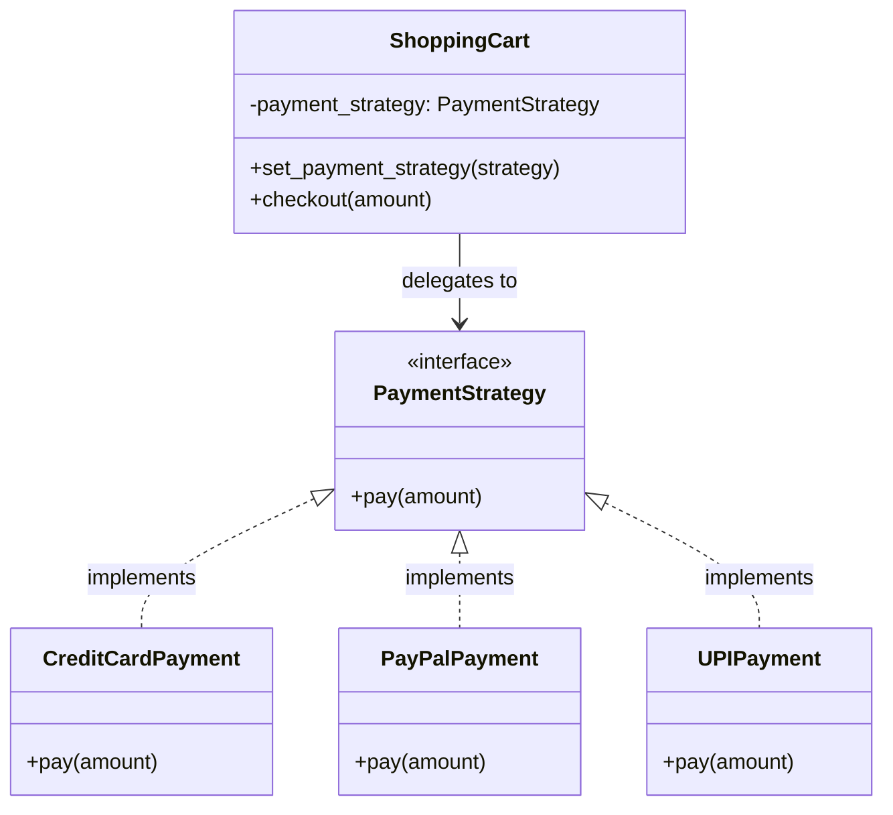


# Strategy Design Pattern

## 1. Definition

The **Strategy Pattern** is a behavioral design pattern that defines a family of algorithms, encapsulates each algorithm in a separate class, and makes them interchangeable at runtime.

It allows the algorithm to vary independently of the client that uses it.

**Example:** A shopping cart can use Credit Card, PayPal, or UPI as interchangeable payment strategies.

---

## 2. Problem Without the Strategy Pattern

Suppose a shopping cart supports multiple payment methods.

A naive implementation might use conditional statements:

```python
class ShoppingCart:
    def checkout(self, amount, payment_method):
        if payment_method == "credit_card":
            print(f"Paid ₹{amount} using Credit Card")
        elif payment_method == "paypal":
            print(f"Paid ₹{amount} using PayPal")
        elif payment_method == "upi":
            print(f"Paid ₹{amount} using UPI")
```

### Problems

- Every new payment method requires modifying the existing class.
- Conditional logic becomes increasingly complex.
- Payment algorithms are tightly coupled to the shopping cart.
- Testing and maintaining individual algorithms becomes harder.
- The design violates the Open/Closed Principle when adding new methods requires modifying existing code.

---

## 3. Solution Using the Strategy Pattern

Separate each algorithm into its own class and provide a common interface.

### Main Components

1. **Strategy Interface:** Defines a common method for all algorithms.
2. **Concrete Strategies:** Implement different versions of the algorithm.
3. **Context:** Maintains a reference to a strategy and delegates work to it.
4. **Client:** Selects a strategy and provides it to the context.

---

## 4. Class Diagram



---

## 5. Python Implementation

### Step 1: Create the Strategy Interface

The interface defines the operation that every concrete strategy must implement.

```python
from abc import ABC, abstractmethod

class PaymentStrategy(ABC):
    @abstractmethod
    def pay(self, amount: float) -> None:
        pass
```

### Step 2: Create Concrete Strategies

Each class implements the same interface using its own algorithm.

```python
class CreditCardPayment(PaymentStrategy):
    def pay(self, amount: float) -> None:
        print(f"Paid ₹{amount:.2f} using Credit Card")


class PayPalPayment(PaymentStrategy):
    def pay(self, amount: float) -> None:
        print(f"Paid ₹{amount:.2f} using PayPal")


class UPIPayment(PaymentStrategy):
    def pay(self, amount: float) -> None:
        print(f"Paid ₹{amount:.2f} using UPI")
```

### Step 3: Create the Context

The context uses a strategy without needing to know its internal implementation.

```python
class ShoppingCart:
    def __init__(self, payment_strategy: PaymentStrategy):
        self.payment_strategy = payment_strategy

    def set_payment_strategy(
        self, payment_strategy: PaymentStrategy
    ) -> None:
        self.payment_strategy = payment_strategy

    def checkout(self, amount: float) -> None:
        self.payment_strategy.pay(amount)
```

### Step 4: Use the Strategy

The client selects a strategy and can change it at runtime.

```python
if __name__ == "__main__":
    cart = ShoppingCart(CreditCardPayment())
    cart.checkout(1500)

    cart.set_payment_strategy(PayPalPayment())
    cart.checkout(2500)

    cart.set_payment_strategy(UPIPayment())
    cart.checkout(750)
```

### Output

```text
Paid ₹1500.00 using Credit Card
Paid ₹2500.00 using PayPal
Paid ₹750.00 using UPI
```

---

## 6. Relationships Between Classes

### 6.1 Realization

**Concrete Strategies → Strategy Interface**

- `CreditCardPayment`, `PayPalPayment`, and `UPIPayment` implement `PaymentStrategy`.
- Each concrete strategy provides its own implementation of `pay()`.
- UML notation: dashed line with a hollow triangle pointing toward the interface.

### 6.2 Association

**ShoppingCart → PaymentStrategy**

- The shopping cart holds a reference to a strategy object.
- It delegates payment processing to that object.
- The strategy can be changed at runtime.
- UML commonly represents this using a solid line with an arrow indicating navigability.

### 6.3 Dependency

**Client → Concrete Strategies**

- The client creates or selects concrete strategy objects.
- It passes the selected strategy to the context.
- The client chooses the algorithm without implementing the algorithm itself.

---

## 7. How the Strategy Pattern Works

1. The client creates a concrete strategy.
2. The client supplies the strategy to the context.
3. The context receives a request, such as `checkout()`.
4. The context delegates the operation to the selected strategy.
5. The concrete strategy executes its algorithm.
6. The client can replace the strategy whenever necessary.

**Important:** The context delegates algorithm execution rather than implementing every algorithm itself.

---

## 8. When to Use the Strategy Pattern

Use it when:

- Multiple algorithms solve the same problem.
- You need to switch algorithms at runtime.
- A class contains complex conditional logic for selecting behavior.
- You want to add new algorithms without changing the context.
- Different behaviors should be independently testable and maintainable.

### Real-World Examples

| Domain | Strategies |
|---|---|
| E-commerce | Credit Card, PayPal, UPI payment |
| Navigation | Shortest route, fastest route, toll-free route |
| File compression | ZIP, GZIP, BZIP2 |
| Sorting | Quick Sort, Merge Sort, Heap Sort |
| Notifications | Email, SMS, Push Notification |
| Game development | Aggressive AI, Defensive AI, Passive AI |
| Authentication | Password, OTP, OAuth-based authentication |

---

## 9. Advantages

- **Open/Closed Principle:** New strategies can be added without modifying the context.
- **Single Responsibility Principle:** Each strategy handles one algorithm.
- **Loose Coupling:** The context depends on an abstraction rather than concrete implementations.
- **Runtime Flexibility:** The algorithm can be changed dynamically.
- **Testability:** Each strategy can be tested independently.
- **Reduced Conditional Logic:** Avoids large `if/elif` blocks for algorithm selection.

---

## 10. Disadvantages

- Increases the number of classes in the system.
- The client must select an appropriate strategy.
- For very simple algorithms, the pattern may introduce unnecessary complexity.
- Strategies may share little code, so a common interface does not necessarily eliminate duplication.

---

## 11. Strategy Pattern and SOLID Principles

### Open/Closed Principle (OCP)

The system can support new payment strategies by adding new classes instead of modifying `ShoppingCart`.

### Single Responsibility Principle (SRP)

Each concrete strategy is responsible for its own payment algorithm.

### Dependency Inversion Principle (DIP)

The context depends on the `PaymentStrategy` abstraction rather than concrete payment classes.

### Liskov Substitution Principle (LSP)

Any valid concrete strategy should be usable wherever `PaymentStrategy` is expected without breaking the context's intended behavior.

---

## 12. Strategy Pattern vs. State Pattern

Both patterns can delegate behavior to separate objects, but their intent differs.

| Strategy Pattern | State Pattern |
|---|---|
| Chooses an algorithm or behavior | Models behavior that changes with an object's state |
| Usually selected by the client | Often changes as the object transitions between states |
| Strategies are generally interchangeable | State objects represent distinct states and their transitions |
| Example: choosing a payment method | Example: a traffic light changing from red to green |

---

## 13. Strategy Pattern vs. Factory Pattern

These patterns solve different problems and can be used together.

| Strategy Pattern | Factory Pattern |
|---|---|
| Encapsulates interchangeable algorithms | Encapsulates object creation |
| Focuses on behavior | Focuses on instantiation |
| Lets the context delegate to a selected strategy | Creates or selects an object to return |

A factory can create the correct strategy, while the Strategy Pattern defines how that strategy performs its operation.

---

## 14. Common Interview Questions

1. What is the Strategy Design Pattern?
2. Which design problem does it solve?
3. What are the main components of the pattern?
4. How does it follow the Open/Closed Principle?
5. Why should the context depend on an interface?
6. How is Strategy different from State?
7. How is Strategy different from Factory?
8. Can strategies be switched at runtime?
9. What are the trade-offs of using this pattern?
10. Give a real-world example of Strategy in a Low-Level Design interview.

---

## 15. Practice Exercises

1. Implement a navigation system with walking, driving, and cycling strategies.
2. Implement a file compression utility with ZIP and GZIP strategies.
3. Implement a game character with aggressive, defensive, and passive combat strategies.
4. Implement a discount system with percentage, fixed-amount, and seasonal discount strategies.
5. Refactor a class with multiple `if/elif` branches into the Strategy Pattern.

### Key Takeaways

- Strategy is a **behavioral design pattern**.
- It encapsulates interchangeable algorithms behind a common interface.
- The context delegates behavior to the selected strategy.
- Concrete strategies implement the same interface.
- Strategies can be switched at runtime.
- It is especially useful for reducing conditional logic and supporting extensible behavior.
# Strategy Pattern
