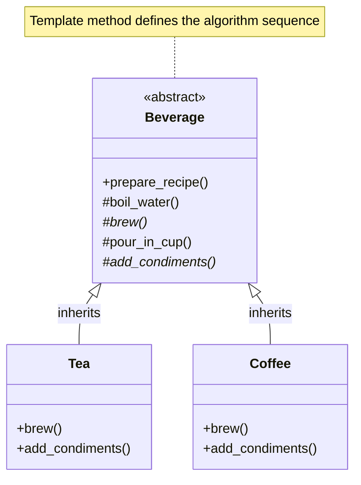


# Template Method Pattern — Low-Level Design Notes

## 1. What Is the Template Method Pattern?

The **Template Method Pattern** is a behavioral design pattern that defines the skeleton of an algorithm in a base class while allowing subclasses to customize specific steps without changing the overall algorithm structure.

The base class determines **what steps happen and in what order**, while subclasses determine **how certain steps are performed**.

### Real-World Examples

- **Making tea or coffee:** Both involve boiling water, preparing ingredients, pouring into a cup, and optionally adding extras.
- **Data processing:** Read data, process it, and generate output, with different implementations for CSV, JSON, or XML.
- **Report generation:** Follow the same report-generation process but customize how each report section is created.
- **Game development:** Different game modes can share a common initialization and gameplay loop while customizing individual steps.

### Key Idea

**The algorithm structure remains fixed, but selected steps can vary.**

---

## 2. The Problem Without the Template Method Pattern

Imagine implementing tea and coffee preparation independently.

```python
class Tea:
    def prepare(self):
        print("Boiling water")
        print("Steeping tea")
        print("Pouring into cup")
        print("Adding lemon")


class Coffee:
    def prepare(self):
        print("Boiling water")
        print("Brewing coffee")
        print("Pouring into cup")
        print("Adding sugar and milk")
```

### Problems

- Common steps are duplicated.
- The algorithm's structure is repeated in multiple classes.
- One subclass might accidentally execute steps in a different order.
- Changing a common step requires updating multiple implementations.

**Solution:** Move the common algorithm into a base class and allow subclasses to override only the steps that differ.

---

## 3. Structure and Components

The Template Method Pattern generally contains two main components.

### 1. Abstract Class

Defines the template method, which controls the sequence of algorithm steps.

It may contain:
- **Concrete methods:** Shared implementation of common steps.
- **Abstract methods:** Steps that subclasses must implement.
- **Hook methods:** Optional methods that subclasses may override.

### 2. Concrete Class

Inherits from the abstract class and implements or overrides the customizable steps.

### Important Terms

| Term | Meaning |
|---|---|
| Template method | Defines the algorithm's overall sequence |
| Primitive operation | A step implemented by a subclass |
| Hook method | An optional customization point with a default implementation |
| Concrete operation | A shared step implemented in the base class |

---

## UML Class Diagram — Template Method Pattern



The `prepare_recipe()` method is the template method. It calls the steps in a fixed order, while `Tea` and `Coffee` customize the brewing and condiment steps.

---

## 5. Python Implementation

### Step 1: Create the Abstract Base Class

```python
from abc import ABC, abstractmethod


class Beverage(ABC):

    def prepare_recipe(self):
        self.boil_water()
        self.brew()
        self.pour_in_cup()
        self.add_condiments()

    def boil_water(self):
        print("Boiling water")

    @abstractmethod
    def brew(self):
        pass

    def pour_in_cup(self):
        print("Pouring into cup")

    @abstractmethod
    def add_condiments(self):
        pass
```

### Step 2: Create Concrete Subclasses

```python
class Tea(Beverage):

    def brew(self):
        print("Steeping the tea")

    def add_condiments(self):
        print("Adding lemon")


class Coffee(Beverage):

    def brew(self):
        print("Brewing the coffee")

    def add_condiments(self):
        print("Adding sugar and milk")
```

### Step 3: Execute the Template Method

```python
tea = Tea()
tea.prepare_recipe()

print()

coffee = Coffee()
coffee.prepare_recipe()
```

### Output

```text
Boiling water
Steeping the tea
Pouring into cup
Adding lemon

Boiling water
Brewing the coffee
Pouring into cup
Adding sugar and milk
```

### How It Works

1. The client creates a `Tea` or `Coffee` object.
2. The client calls `prepare_recipe()`.
3. The base class controls the sequence of operations.
4. Subclass implementations are invoked for `brew()` and `add_condiments()`.
5. The algorithm completes without duplicating its shared structure.

**Important:** In Python, calling an overridden method from a base-class method invokes the subclass implementation through normal method dispatch.

---

## 6. Template Method vs Hook Methods

A hook is a method in the base class that provides a default behavior and can optionally be overridden.

Hooks are useful when a step should not be mandatory for every subclass.

### Example: Optional Condiments

```python
from abc import ABC, abstractmethod


class Beverage(ABC):

    def prepare_recipe(self):
        self.boil_water()
        self.brew()
        self.pour_in_cup()

        if self.customer_wants_condiments():
            self.add_condiments()

    def boil_water(self):
        print("Boiling water")

    @abstractmethod
    def brew(self):
        pass

    def pour_in_cup(self):
        print("Pouring into cup")

    def add_condiments(self):
        print("Adding default condiments")

    def customer_wants_condiments(self):
        return True  # Hook method


class BlackCoffee(Beverage):

    def brew(self):
        print("Brewing black coffee")

    def customer_wants_condiments(self):
        return False
```

Usage:

```python
coffee = BlackCoffee()
coffee.prepare_recipe()
```

The subclass changes the hook's return value to skip the optional condiment step.

### Abstract Method vs Hook Method

| Abstract Method | Hook Method |
|---|---|
| Must be implemented by a concrete subclass | Can be overridden optionally |
| Usually has no complete default behavior | Usually provides default behavior |
| Defines a required variation point | Defines an optional variation point |

---

## 7. Important Design Rule: Control the Algorithm

The template method should generally be the stable entry point for the algorithm.

In languages that support access modifiers, it is often declared `final` to prevent subclasses from changing the overall sequence.

Python does not enforce Java-style `final` method behavior at runtime. You can use `typing.final` as a static type-checking hint, but it does not prevent overriding at runtime.

### Why This Matters

Suppose every beverage must follow these steps:

1. Boil water.
2. Brew the beverage.
3. Pour into a cup.
4. Add optional condiments.

If a subclass replaces `prepare_recipe()` entirely, it could skip required steps or change their order. Keeping the template method stable helps preserve the algorithm's intended structure.

---

## 8. When Should You Use the Template Method Pattern?

Use it when:

- Multiple classes implement the same overall algorithm.
- The order of operations must remain consistent.
- Some steps are common while others vary.
- You want to avoid duplicating algorithm structure.
- Subclasses should customize selected steps rather than rewrite the entire process.

### Common Applications

| Application | Template Method Usage |
|---|---|
| Beverage preparation | Common preparation steps |
| Data import | Read, validate, transform, and save data |
| Report generation | Common report workflow with different content |
| Testing frameworks | Shared test lifecycle with customizable test cases |
| Build systems | Common build steps with project-specific tasks |
| Game development | Common lifecycle with mode-specific behavior |

---

## 9. Advantages

1. **Code Reuse:** Common steps live in one base class.
2. **Consistent Workflow:** The base class controls the order of operations.
3. **Extensibility:** Subclasses customize selected steps.
4. **Reduced Duplication:** Shared algorithm structure is implemented once.
5. **Open/Closed Principle:** New variants can often be added without changing the template.

## 10. Disadvantages

1. **Inheritance Dependency:** The pattern relies on a base-class/subclass relationship.
2. **Limited Flexibility:** Changing the algorithm's overall structure may require modifying the base class.
3. **Risk of Fragile Base Classes:** Changes to shared methods can unintentionally affect every subclass.
4. **Complexity:** A simple algorithm may not justify the extra classes and abstractions.
5. **Inheritance Constraints:** A subclass may need to inherit from another class, making the design harder to compose.

---

## 11. Template Method Pattern and SOLID Principles

### Single Responsibility Principle (SRP)

The base class manages the algorithm's overall workflow, while subclasses implement variations in individual steps.

Avoid putting unrelated responsibilities into the same hierarchy.

### Open/Closed Principle (OCP)

New subclasses can provide new variations without rewriting the template algorithm.

### Liskov Substitution Principle (LSP)

Concrete subclasses should honor the base class's behavioral expectations and required steps.

### Note

The pattern can support SOLID principles, but it does not guarantee that every implementation follows them.

---

## 12. Template Method vs Strategy Pattern

Both patterns allow behavior to vary, but they achieve it differently.

| Feature | Template Method | Strategy |
|---|---|---|
| Category | Behavioral | Behavioral |
| Main technique | Inheritance | Composition |
| Algorithm structure | Defined by the base class | Encapsulated in interchangeable strategy objects |
| What varies? | Selected steps | The algorithm or behavior being delegated |
| Runtime switching | Usually less flexible | Strategies can generally be switched at runtime |
| Example | Tea and coffee share a preparation workflow | Choosing UPI or credit card for payment |

### Example

**Template Method:** All reports follow `collect_data() → process_data() → generate_report()`, with subclasses implementing selected steps.

**Strategy:** A report generator receives a `CSVExportStrategy` or `PDFExportStrategy` and delegates the export operation to it.

### Quick Rule

- Use **Template Method** when the overall sequence should stay the same.
- Use **Strategy** when you want to swap complete algorithms or behaviors.

---

## 13. Template Method vs Factory Method

These patterns are related, but they solve different problems.

| Feature | Template Method | Factory Method |
|---|---|---|
| Purpose | Define an algorithm's structure | Delegate object creation to subclasses |
| Main concern | Steps in a workflow | Which object gets created |
| Example | Common beverage preparation process | Create a specific type of beverage |

**Important:** Factory Method is itself a design pattern and can sometimes be used as one step inside a template algorithm. They are not mutually exclusive.

---

## 14. Common Mistakes

- Duplicating the same algorithm in every subclass.
- Allowing subclasses to rewrite the entire workflow unnecessarily.
- Making every step abstract even when some steps can be shared.
- Using hooks for steps that should be mandatory.
- Making the base class overly complicated with too many customization points.
- Choosing inheritance when composition would provide better flexibility.

---

## 15. Interview Questions

### Beginner

1. What is the Template Method Pattern?
2. Why is it a behavioral design pattern?
3. What is a template method?
4. What are primitive operations?
5. What is a hook method?

### Intermediate

6. How does Template Method reduce code duplication?
7. What is the difference between an abstract method and a hook?
8. How does Template Method follow the Open/Closed Principle?
9. What are the disadvantages of inheritance-based design?
10. Can a template method call overridden subclass methods?

### Advanced

11. How does Template Method differ from Strategy?
12. How would you implement a data-import workflow using Template Method?
13. How can you prevent subclasses from changing the algorithm's sequence?
14. When would composition be preferable to Template Method?
15. Can Template Method and Factory Method work together?

---

## 16. Practice Exercises

### Exercise 1: Data Import System

Create a base class called `DataImporter` with the following workflow:

1. Read the file.
2. Validate the data.
3. Transform the data.
4. Save the results.

Create subclasses for CSV and JSON imports.

### Exercise 2: Report Generation

Create a base class called `ReportGenerator`.

Common steps:
- Collect data.
- Format the report.
- Export the report.

Create different implementations for PDF and HTML reports.

### Exercise 3: Game Lifecycle

Create a base class called `Game` with a template method that:

1. Initializes the game.
2. Loads resources.
3. Starts gameplay.
4. Cleans up resources.

Implement different games that customize selected steps.

### Exercise 4: Online Order Processing

Design a fixed workflow:

1. Validate order.
2. Process payment.
3. Prepare shipment.
4. Send confirmation.

Allow subclasses to customize shipment preparation and confirmation while preserving the workflow.

---

## 17. Quick Revision

- **Pattern category:** Behavioral
- **Intent:** Define an algorithm's skeleton and allow subclasses to customize selected steps.
- **Main components:** Abstract base class and concrete subclasses.
- **Core method:** Template method
- **Supporting methods:** Abstract methods, concrete methods, and hook methods.
- **Main technique:** Inheritance
- **Main benefit:** Reuse common algorithm structure while maintaining a consistent sequence.
- **Common applications:** Data processing, report generation, testing workflows, and game lifecycles.
- **Related patterns:** Strategy and Factory Method.

### One-Line Summary

The Template Method Pattern defines the steps and order of an algorithm in a base class while allowing subclasses to customize selected steps without changing the overall workflow.