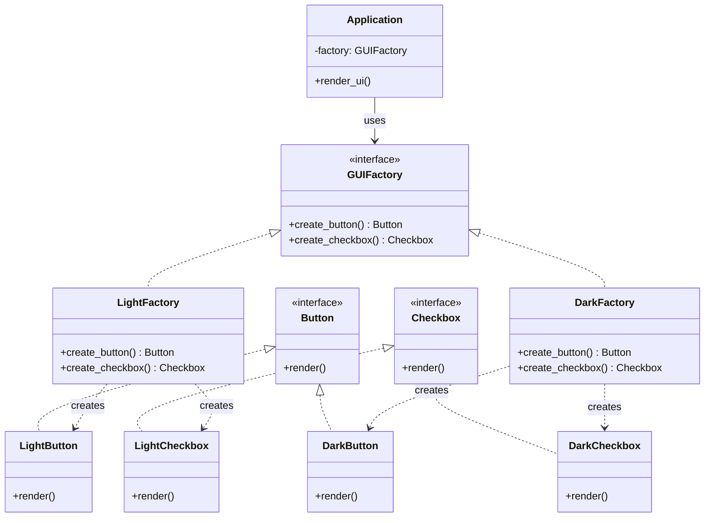
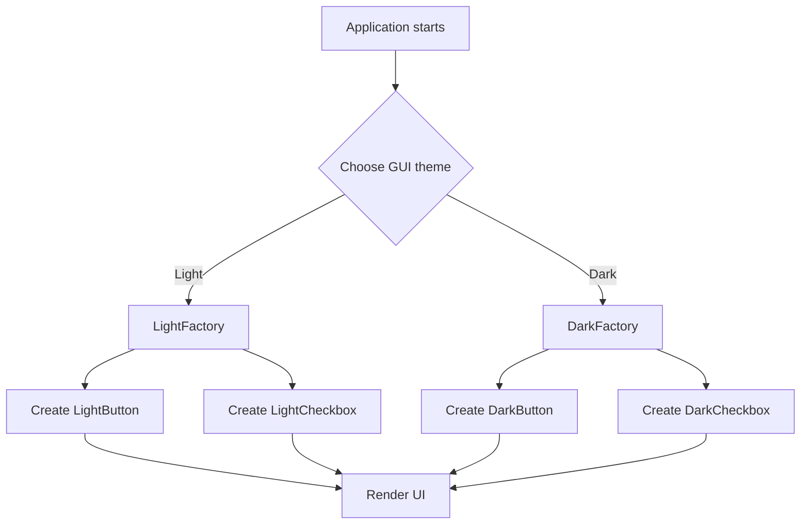
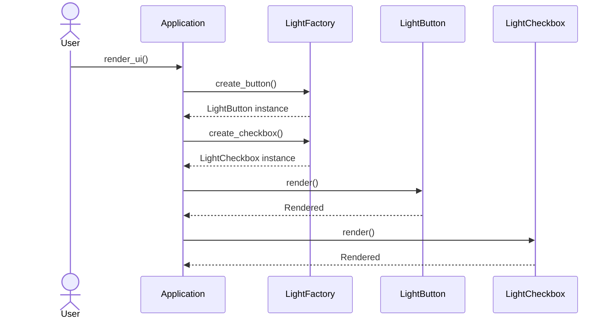

# Abstract Factory Pattern

## 1. What Is the Abstract Factory Pattern?

The **Abstract Factory Pattern** is a creational design pattern that provides an interface for creating **families of related objects without specifying their concrete classes**.

It is useful when an application needs multiple related objects that must work together.

### Real-World Example

Imagine you are building a UI application that supports two themes:

- Light Theme
- Dark Theme

Each theme contains related UI components:
- Button
- Checkbox

The Light Theme should create light buttons and light checkboxes, while the Dark Theme should create dark buttons and dark checkboxes.

Instead of creating each component independently, we use an Abstract Factory to create a complete family of related components.

## 2. Problem Without Abstract Factory

Suppose we create components directly:

```python
button = LightButton()
checkbox = DarkCheckbox()
```

This can accidentally mix components from different families.

As the application grows, the client code must also know which concrete classes to instantiate.

**Problems:**
- Client code becomes tightly coupled to concrete classes.
- Related objects can accidentally come from incompatible families.
- Adding new product families requires changes across the application.
- Object creation logic may become duplicated.

The Abstract Factory Pattern helps centralize object creation and maintain consistency between related objects.

## 3. Structure of Abstract Factory

The pattern typically contains five major parts:

| Component | Responsibility |
|---|---|
| Abstract Factory | Declares methods for creating related products |
| Concrete Factory | Creates a specific family of products |
| Abstract Product | Defines the interface of a product |
| Concrete Product | Implements a specific product |
| Client | Uses abstract interfaces without depending on concrete classes |

## 4. UML Class Diagram



### Understanding the Diagram

- `GUIFactory` defines methods to create buttons and checkboxes.
- `LightFactory` creates light-themed components.
- `DarkFactory` creates dark-themed components.
- `Button` and `Checkbox` are abstract product interfaces.
- Concrete products implement the respective interfaces.
- `Application` depends on `GUIFactory`, not on `LightFactory` or `DarkFactory`.

The client can switch between product families by changing the factory it receives.

## 5. Python Implementation

### Step 1: Create Abstract Product Interfaces

```python
from abc import ABC, abstractmethod


class Button(ABC):
    @abstractmethod
    def render(self) -> None:
        pass


class Checkbox(ABC):
    @abstractmethod
    def render(self) -> None:
        pass
```

These interfaces define the behavior expected from every button and checkbox.

They do not specify how each component should look.

### Step 2: Create Concrete Products

```python
class LightButton(Button):
    def render(self) -> None:
        print("Rendering Light Button")


class DarkButton(Button):
    def render(self) -> None:
        print("Rendering Dark Button")


class LightCheckbox(Checkbox):
    def render(self) -> None:
        print("Rendering Light Checkbox")


class DarkCheckbox(Checkbox):
    def render(self) -> None:
        print("Rendering Dark Checkbox")
```

Each concrete product implements the interface for its respective component.

For example, `LightButton` and `DarkButton` both satisfy the `Button` interface, but their implementations differ.

### Step 3: Create the Abstract Factory

```python
class GUIFactory(ABC):
    @abstractmethod
    def create_button(self) -> Button:
        pass

    @abstractmethod
    def create_checkbox(self) -> Checkbox:
        pass
```

The abstract factory defines the creation methods required for every GUI theme.

It does not decide which concrete button or checkbox should be created.

### Step 4: Create Concrete Factories

```python
class LightFactory(GUIFactory):
    def create_button(self) -> Button:
        return LightButton()

    def create_checkbox(self) -> Checkbox:
        return LightCheckbox()


class DarkFactory(GUIFactory):
    def create_button(self) -> Button:
        return DarkButton()

    def create_checkbox(self) -> Checkbox:
        return DarkCheckbox()
```

Each concrete factory creates a consistent family of products.

**LightFactory:**
- Creates `LightButton`
- Creates `LightCheckbox`

**DarkFactory:**
- Creates `DarkButton`
- Creates `DarkCheckbox`

The client does not need to know these concrete class names.

### Step 5: Create the Client Application

```python
class Application:
    def __init__(self, factory: GUIFactory) -> None:
        self.factory = factory

    def render_ui(self) -> None:
        button = self.factory.create_button()
        checkbox = self.factory.create_checkbox()

        button.render()
        checkbox.render()
```

Notice this constructor:

```python
def __init__(self, factory: GUIFactory) -> None:
    self.factory = factory
```

The application receives a factory rather than constructing one internally.

This is an example of **Dependency Injection**.

The application only knows that the factory can create a `Button` and a `Checkbox`. It does not need to know the actual concrete classes.

### Step 6: Run the Application

```python
# Light theme
light_factory = LightFactory()
light_app = Application(light_factory)

light_app.render_ui()

print("---")

# Dark theme
dark_factory = DarkFactory()
dark_app = Application(dark_factory)

dark_app.render_ui()
```

Output:

```text
Rendering Light Button
Rendering Light Checkbox
---
Rendering Dark Button
Rendering Dark Checkbox
```

The same application works with both product families.

We change the factory rather than changing the application's rendering logic.

## 6. Execution Flow Diagram



The selected factory determines which concrete products are created.

## 7. Sequence Diagram



This sequence shows how the application requests products from the factory and then uses the returned objects.

## 8. Why Not Just Use a Factory Method?

Both patterns are creational patterns, but they solve different problems.

| Feature | Factory Method | Abstract Factory |
|---|---|---|
| Main purpose | Delegate creation of a product to a creator method | Create families of related products |
| Product focus | Usually one product abstraction per factory method | Multiple related product abstractions |
| Typical example | Create an email or SMS notification | Create matching buttons and checkboxes for a theme |
| Structure | Creator and concrete creators | Abstract factory, concrete factories, multiple product interfaces |
| Best when | Creation of one product varies | A group of related products must vary together |

### Factory Method Example

```python
notification = EmailNotification()
```

A Factory Method design lets a creator decide which notification product to construct.

### Abstract Factory Example

```python
factory = LightFactory()

button = factory.create_button()
checkbox = factory.create_checkbox()
```

The factory creates a related family of GUI components.

**Easy way to remember:**

- Factory Method → How should this product be created?
- Abstract Factory → Which family of related products should be created?

## 9. Abstract Factory vs Simple Factory

| Feature | Simple Factory | Abstract Factory |
|---|---|---|
| Purpose | Create one of several product types | Create families of related products |
| Structure | Often one class with a selection method | Abstract factory and concrete factory implementations |
| Number of product categories | Often one | Multiple related categories |
| Consistency across products | Must be handled separately | Encouraged by the selected factory family |
| Complexity | Lower | Higher |

A Simple Factory is often a useful lightweight approach. Abstract Factory becomes more valuable when multiple related product categories need to vary together.

## 10. Relationship with SOLID Principles

### Single Responsibility Principle (SRP)

The factory handles object creation, while product classes handle their own behavior.

### Open/Closed Principle (OCP)

You can introduce a new product family by adding a new concrete factory and its products without changing the existing client application, provided the existing interfaces remain suitable.

### Liskov Substitution Principle (LSP)

Concrete factories should be usable wherever `GUIFactory` is expected, and concrete products should satisfy their respective product interfaces.

### Interface Segregation Principle (ISP)

Separate product interfaces, such as `Button` and `Checkbox`, keep contracts focused on the behavior each product requires.

### Dependency Inversion Principle (DIP)

The application depends on `GUIFactory`, `Button`, and `Checkbox` abstractions instead of directly depending on concrete classes.

## 11. Advantages

- **Loose coupling:** Client code depends on abstractions.
- **Product consistency:** A factory creates products belonging to the same family.
- **Easy family switching:** The application can switch between themes or platforms.
- **Centralized creation:** Object construction is delegated to factory implementations.
- **Testability:** Mock factories can be injected into the client.
- **Extensibility:** New product families can be added through new concrete factories.

## 12. Disadvantages

- **More classes:** Each family may need its own factory and concrete products.
- **More abstractions:** The design can feel unnecessarily complicated for small applications.
- **Adding a product category can be expensive:** Adding a new method to the abstract factory may require updating every concrete factory.
- **Risk of overengineering:** If there is only one product type or no real need for product families, a simpler factory may be sufficient.

For example, adding a `Slider` product would require adding `create_slider()` to `GUIFactory` and implementing it in `LightFactory`, `DarkFactory`, and any other concrete factories.

## 13. When Should You Use Abstract Factory?

Use it when:

1. Your application needs multiple related objects.
2. Those objects must work together as a consistent family.
3. The application must switch between product families.
4. You want client code to depend on abstractions rather than concrete classes.
5. New product families are expected to be added over time.

### Real-World Use Cases

- **Cross-platform GUI:** Windows, macOS, and Linux UI components.
- **Themes:** Light and dark buttons, checkboxes, dialogs, and menus.
- **Database integrations:** Related connection, command, and transaction objects, when the library benefits from a common family interface.
- **Cloud providers:** Related storage, queue, and messaging clients for different providers.
- **Game development:** Families of related characters, weapons, effects, and UI elements for different factions or game environments.

The pattern is most useful when products need to vary together, not merely because an application has many classes.

## 14. Interview Questions

### Q1. What is the Abstract Factory Pattern?

A creational pattern that provides an interface for creating families of related objects without specifying their concrete classes.

### Q2. What problem does it solve?

It reduces coupling between client code and concrete product classes while helping ensure that related objects come from the same family.

### Q3. Can Abstract Factory be implemented without abstract classes?

Yes. Python protocols, duck typing, or other interface-like conventions can provide the required contracts. Abstract base classes are one possible implementation.

### Q4. How does it support Dependency Inversion?

The client depends on an abstract factory and abstract products rather than concrete implementations.

### Q5. What happens when you add a new product family?

You typically add a new concrete factory and its products. Existing client code can remain unchanged if it uses only the abstract interfaces.

### Q6. What happens when you add a new product category?

You often need to extend the abstract factory interface and update every concrete factory to implement the new creation method.

### Q7. Is Abstract Factory the same as Factory Method?

No. Factory Method focuses on delegating the creation of a product, while Abstract Factory focuses on creating a family of related products. Abstract Factory implementations may themselves use Factory Methods internally.

## 15. Practice Exercises

1. Create a `WindowsFactory` and a `MacFactory` that each create a button and a checkbox.
2. Add a `Dialog` product to the GUI family.
3. Create a game factory that produces related `Character` and `Weapon` objects.
4. Write unit tests to verify that `LightFactory` only creates light-themed components.
5. Inject a fake `GUIFactory` into `Application` to test its rendering behavior without using real GUI components.

## 16. Key Takeaways

- Abstract Factory is a **creational design pattern**.
- It creates families of related objects without exposing their concrete classes to the client.
- The abstract factory defines creation methods.
- Concrete factories implement those methods for specific product families.
- The client depends on abstractions and receives a factory through dependency injection.
- It is particularly useful when related products must vary together.
- Its primary trade-off is additional complexity, especially when new product categories are introduced.
