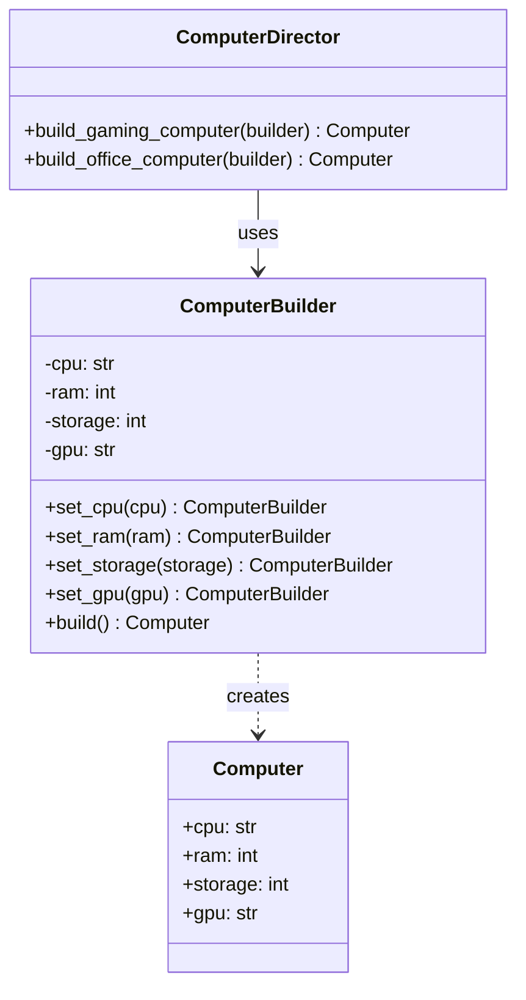
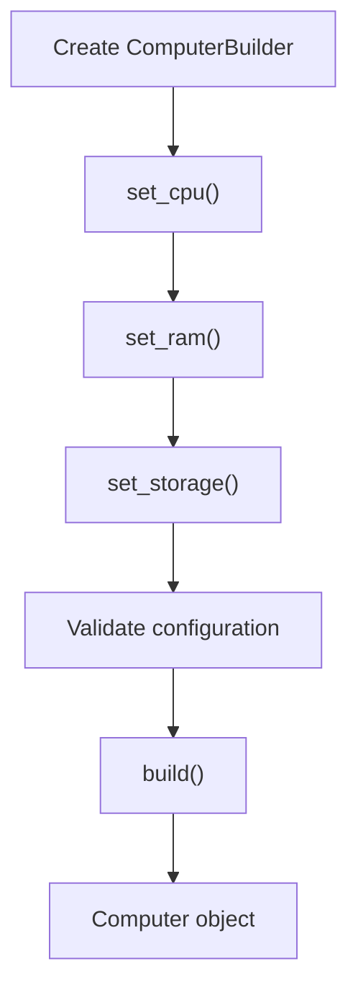
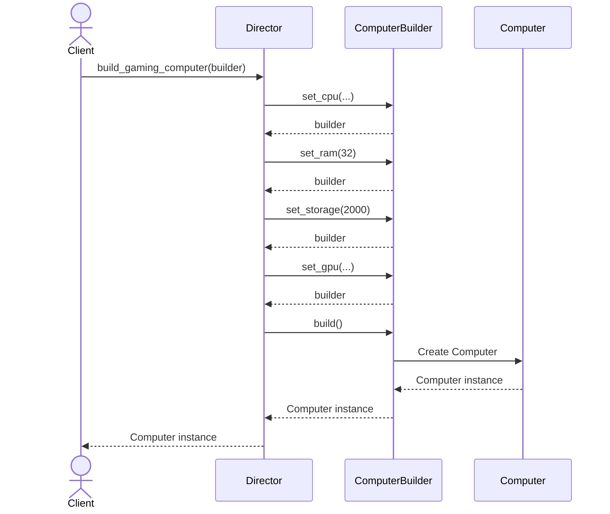

# Builder Design Pattern

## 1. What Is the Builder Design Pattern?

The **Builder Design Pattern** is a creational design pattern used to construct complex objects step by step.

It separates the construction of an object from its final representation, allowing the same construction process to create different representations.

Instead of creating an object with a constructor that takes many parameters, we build the object gradually by calling specific methods.

### Real-World Example

Imagine building a computer. A computer can have different configurations:

- CPU
- RAM
- Storage
- Graphics card
- Operating system

You might want to build:

- A basic office computer
- A gaming computer
- A high-performance workstation

Passing every option into one large constructor can become difficult to read and maintain. The Builder Pattern lets you configure the object step by step.

```python
computer = (
    ComputerBuilder()
    .set_cpu("Intel Core i7")
    .set_ram(32)
    .set_storage(1000)
    .set_gpu("NVIDIA RTX")
    .build()
)
```

The builder collects the configuration and creates the final `Computer` object.

## 2. The Problem Without the Builder Pattern

Consider a class with many optional parameters:

```python
class Computer:
    def __init__(
        self,
        cpu,
        ram,
        storage,
        gpu=None,
        wifi=True,
        bluetooth=True,
    ):
        self.cpu = cpu
        self.ram = ram
        self.storage = storage
        self.gpu = gpu
        self.wifi = wifi
        self.bluetooth = bluetooth
```

Creating objects can become confusing:

```python
computer = Computer(
    "Intel Core i7",
    32,
    1000,
    "NVIDIA RTX",
    True,
    True,
)
```

Questions arise:

- What does each positional argument represent?
- Which arguments are optional?
- How do we handle many configuration combinations?
- How do we ensure the object is configured correctly?

Keyword arguments improve readability:

```python
computer = Computer(
    cpu="Intel Core i7",
    ram=32,
    storage=1000,
    gpu="NVIDIA RTX",
)
```

However, for complex objects with many construction steps, dependencies, validations, or alternative configurations, a Builder can offer a clearer construction API.

## 3. Structure of the Builder Pattern

The classic Builder Pattern has four main participants.

| Component | Responsibility |
|---|---|
| Product | The complex object being constructed |
| Builder | Declares the steps required to construct the product |
| Concrete Builder | Implements the construction steps |
| Director | Defines a particular construction sequence using a builder |

The Director is optional in many modern implementations. A fluent builder can expose methods that the client chains together directly.

## 4. UML Class Diagram



### Understanding the Diagram

- `Computer` is the final product.
- `ComputerBuilder` provides methods to configure the computer.
- `build()` creates and returns the final object.
- `ComputerDirector` defines reusable construction recipes.
- The client can use the builder directly or ask the Director to follow a predefined recipe.

## 5. Python Implementation

### Step 1: Create the Product

```python
class Computer:
    def __init__(
        self,
        cpu: str,
        ram: int,
        storage: int,
        gpu: str | None = None,
    ) -> None:
        self.cpu = cpu
        self.ram = ram
        self.storage = storage
        self.gpu = gpu

    def show_specs(self) -> None:
        print(f"CPU: {self.cpu}")
        print(f"RAM: {self.ram} GB")
        print(f"Storage: {self.storage} GB")
        print(f"GPU: {self.gpu or 'Integrated graphics'}")
```

The `Computer` class represents the object we want to construct.

It doesn't need to know how the builder configures it.

### Step 2: Create the Builder

```python
class ComputerBuilder:
    def __init__(self) -> None:
        self._cpu = "Basic CPU"
        self._ram = 8
        self._storage = 256
        self._gpu: str | None = None

    def set_cpu(self, cpu: str) -> "ComputerBuilder":
        self._cpu = cpu
        return self

    def set_ram(self, ram: int) -> "ComputerBuilder":
        self._ram = ram
        return self

    def set_storage(self, storage: int) -> "ComputerBuilder":
        self._storage = storage
        return self

    def set_gpu(self, gpu: str) -> "ComputerBuilder":
        self._gpu = gpu
        return self

    def build(self) -> Computer:
        if self._ram <= 0:
            raise ValueError("RAM must be greater than zero")

        if self._storage <= 0:
            raise ValueError("Storage must be greater than zero")

        return Computer(
            cpu=self._cpu,
            ram=self._ram,
            storage=self._storage,
            gpu=self._gpu,
        )
```

### Important Concepts

**1. Step-by-step construction**

Each setter configures one part of the computer.

```python
builder.set_cpu("Intel Core i7")
builder.set_ram(32)
builder.set_storage(1000)
```

**2. Returning `self`**

Every setter returns the same builder object:

```python
return self
```

This allows method chaining.

**3. The `build()` method**

The `build()` method validates the configuration and creates the final `Computer` instance.

```python
return Computer(
    cpu=self._cpu,
    ram=self._ram,
    storage=self._storage,
    gpu=self._gpu,
)
```

The builder is responsible for assembling the final product from the collected configuration.

### Step 3: Use the Builder

```python
computer = (
    ComputerBuilder()
    .set_cpu("Intel Core i7")
    .set_ram(32)
    .set_storage(1000)
    .set_gpu("NVIDIA RTX")
    .build()
)

computer.show_specs()
```

Output:

```text
CPU: Intel Core i7
RAM: 32 GB
Storage: 1000 GB
GPU: NVIDIA RTX
```

The chained calls are equivalent to calling each method separately. The key difference is that the chained version reads like a construction recipe.

## 6. Method Chaining Explained

Consider this expression:

```python
computer = (
    ComputerBuilder()
    .set_cpu("Intel Core i7")
    .set_ram(32)
    .set_storage(1000)
    .build()
)
```

The process is:

1. `ComputerBuilder()` creates a builder instance.
2. `.set_cpu(...)` changes its CPU configuration and returns the builder.
3. `.set_ram(...)` changes its RAM configuration and returns the builder.
4. `.set_storage(...)` changes its storage configuration and returns the builder.
5. `.build()` constructs and returns the final `Computer`.



The builder accumulates the configuration until `build()` is called.

## 7. Builder Pattern with a Director

A Director is useful when your application repeatedly creates standard configurations.

For example, we may frequently need gaming computers and office computers.

### Director Implementation

```python
class ComputerDirector:
    def build_gaming_computer(
        self,
        builder: ComputerBuilder,
    ) -> Computer:
        return (
            builder
            .set_cpu("High-performance CPU")
            .set_ram(32)
            .set_storage(2000)
            .set_gpu("Dedicated gaming GPU")
            .build()
        )

    def build_office_computer(
        self,
        builder: ComputerBuilder,
    ) -> Computer:
        return (
            builder
            .set_cpu("Energy-efficient CPU")
            .set_ram(16)
            .set_storage(512)
            .build()
        )
```

### Using the Director

```python
director = ComputerDirector()

gaming_computer = director.build_gaming_computer(
    ComputerBuilder()
)

office_computer = director.build_office_computer(
    ComputerBuilder()
)

gaming_computer.show_specs()

print("---")

office_computer.show_specs()
```

The Director defines reusable recipes, while the builder performs the construction.

Notice that each recipe receives a fresh builder. This avoids carrying configuration from one build into another.

### Director Sequence Diagram



## 8. Fluent Builder vs Classic Builder

There are two common ways to implement the pattern.

| Feature | Fluent Builder | Classic Builder |
|---|---|---|
| Construction | Client chains builder methods | Director coordinates construction steps |
| Director | Usually optional | Commonly included |
| Flexibility | Client chooses the configuration steps | Director can provide standard recipes |
| Typical use | Configurable objects and APIs | Complex construction processes with reusable sequences |

The Python example above uses a fluent builder, with an optional Director for predefined configurations.

## 9. Builder Pattern vs Factory Pattern

Both are creational patterns, but their goals differ.

| Feature | Builder Pattern | Factory Pattern |
|---|---|---|
| Main purpose | Construct a complex object step by step | Encapsulate object creation |
| Focus | How an object is configured and assembled | Which object or product gets created |
| Typical result | An object built from multiple configuration steps | A product selected or instantiated by a factory |
| Best suited for | Many optional settings, validation, construction sequences | Choosing among product types or families |

### Factory Example

```python
notification = NotificationFactory.create_notification("sms")
```

The factory selects and creates an SMS notification.

### Builder Example

```python
computer = (
    ComputerBuilder()
    .set_cpu("Intel Core i7")
    .set_ram(32)
    .set_storage(1000)
    .build()
)
```

The builder constructs a configured computer step by step.

**Remember:**

- Factory Pattern → Which object should be created?
- Builder Pattern → How should this complex object be constructed?

## 10. Builder Pattern vs Direct Constructor

| Feature | Direct Constructor | Builder Pattern |
|---|---|---|
| Simple objects | Usually ideal | May be unnecessary |
| Many optional parameters | Can become difficult to manage | Can make configuration clearer |
| Construction steps | Usually performed in one call | Performed through multiple methods |
| Validation | Can happen in the constructor | Can be centralized in `build()` |
| Readability | Depends on the number of parameters | Often improves for complex configurations |
| Extra classes | Usually fewer | Requires a builder class |

A builder is not automatically better than a constructor. For a simple object with two or three required fields, a normal constructor or keyword arguments may be sufficient.

## 11. Advantages

- **Readable construction:** Configuration is expressed through named methods.
- **Handles optional parameters:** Optional settings can be applied only when needed.
- **Centralized validation:** The builder can validate configuration before creating the product.
- **Flexible construction:** Different sequences can produce different configurations.
- **Encapsulation:** The client doesn't need to know the product's internal construction details.
- **Reusable recipes:** A Director can define standard construction procedures.

## 12. Disadvantages

- **More code:** A builder adds another class and methods.
- **Potential overengineering:** Simple objects may not need one.
- **Mutable state:** The builder holds configuration while construction is in progress.
- **State leakage:** Reusing a builder without resetting it can accidentally carry settings into later objects.
- **More design decisions:** You must decide which settings are required, optional, validated, or applied during construction.

## 13. When Should You Use the Builder Pattern?

Use the Builder Pattern when:

1. An object has many optional parameters.
2. Object creation involves multiple steps.
3. The construction process needs validation.
4. Different configurations of the same product are required.
5. You want a readable, fluent API.
6. Standard construction recipes need to be reused.

### Real-World Use Cases

- **Computer configuration:** CPU, RAM, storage, graphics.
- **HTTP requests:** URL, headers, query parameters, body, timeout.
- **Database queries:** Conditions, joins, ordering, pagination.
- **Game development:** Characters with configurable equipment and attributes.
- **Document generation:** Reports with sections, formatting, metadata.
- **Application configuration:** Optional settings and feature flags.

## 14. Relationship with SOLID Principles

### Single Responsibility Principle (SRP)

The builder handles construction and configuration, while the product represents the resulting object.

### Open/Closed Principle (OCP)

Construction can be extended with new builder methods or recipes, although changes to the builder's public API may affect existing clients.

### Dependency Inversion Principle (DIP)

In larger designs, clients can depend on a builder interface rather than a concrete builder. This is particularly useful when multiple construction implementations are interchangeable.

The Builder Pattern does not automatically guarantee SOLID compliance; the design and responsibilities of the classes still matter.

## 15. Common Mistakes

### Mistake 1: Forgetting to return `self`

Incorrect:

```python
def set_ram(self, ram: int) -> None:
    self._ram = ram
```

This method returns `None` implicitly, so chaining fails:

```python
builder.set_ram(32).set_storage(1000)
```

Correct:

```python
def set_ram(self, ram: int) -> "ComputerBuilder":
    self._ram = ram
    return self
```

### Mistake 2: Returning the builder instead of the product

Incorrect:

```python
def build(self) -> "ComputerBuilder":
    return self
```

Correct:

```python
def build(self) -> Computer:
    return Computer(
        cpu=self._cpu,
        ram=self._ram,
        storage=self._storage,
        gpu=self._gpu,
    )
```

The purpose of `build()` is to return the finished product.

### Mistake 3: Reusing a builder without managing its state

Suppose you set a GPU for one computer and then reuse the same builder for another. The second computer may unexpectedly retain the first GPU setting.

Prefer creating a new builder for each independent construction, or explicitly implement and document reset behavior.

### Mistake 4: Using a builder for every class

A builder adds value when construction is complex. For a small object, a normal constructor is often simpler and easier to maintain.

## 16. Interview Questions

### Q1. What is the Builder Design Pattern?

A creational pattern that constructs complex objects step by step, separating the construction process from the final product.

### Q2. What problem does it solve?

It helps manage complex construction logic, many optional settings, validation, and alternative configurations.

### Q3. What is the role of the Director?

The Director defines a reusable sequence of construction steps using a builder. It is optional in many implementations.

### Q4. Why do builder methods return `self`?

Returning the same builder instance enables method chaining.

### Q5. Does the Builder Pattern require inheritance?

No. It can be implemented with ordinary classes and composition. Inheritance or abstract builder interfaces may be used when multiple builders need a shared contract.

### Q6. Can a builder create different representations?

Yes. The classic pattern can use different concrete builders to construct different representations through a common construction process, provided the design supports those representations.

### Q7. How is Builder different from Abstract Factory?

Builder focuses on the step-by-step construction of a complex object. Abstract Factory focuses on creating families of related objects.

### Q8. Is the Director mandatory?

No. A client can invoke builder methods directly. A Director is useful when construction recipes need to be centralized and reused.

## 17. Practice Exercises

1. Create a `PizzaBuilder` with methods for selecting size, crust, cheese, and toppings.
2. Add validation to ensure a pizza has a valid size.
3. Create a `ReportBuilder` that supports a title, introduction, body, and conclusion.
4. Build a `GameCharacterBuilder` with health, strength, weapon, and armor.
5. Add a Director that creates predefined warrior, mage, and archer characters.
6. Write tests to verify that invalid configurations raise appropriate exceptions.
7. Compare your builder implementation with a constructor that uses keyword-only arguments.

## 18. Key Takeaways

- Builder is a **creational design pattern**.
- It constructs complex objects step by step.
- It separates construction logic from the final product.
- Builder methods often return `self` to support method chaining.
- The `build()` method returns the final object.
- A Director is optional and can provide reusable construction recipes.
- Builder is useful for complex objects with many optional settings or construction steps.
- Avoid using it when a simple constructor already provides a clear solution.
