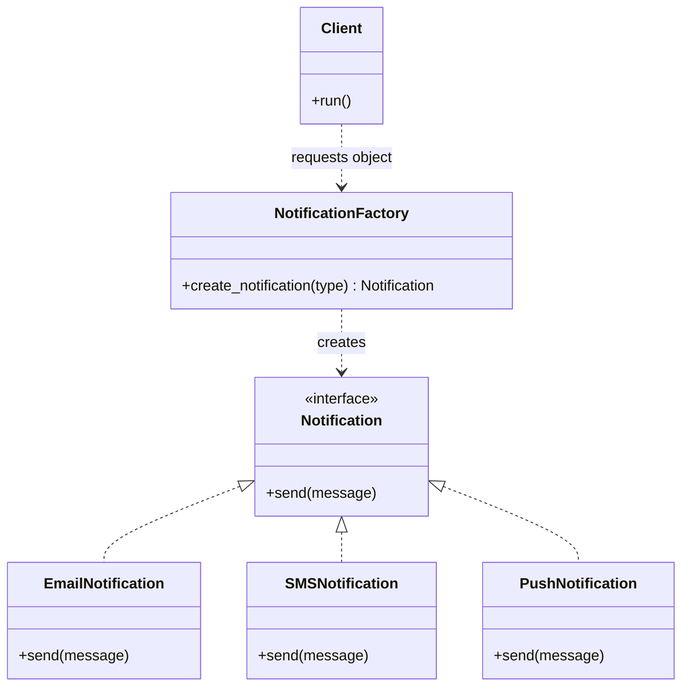
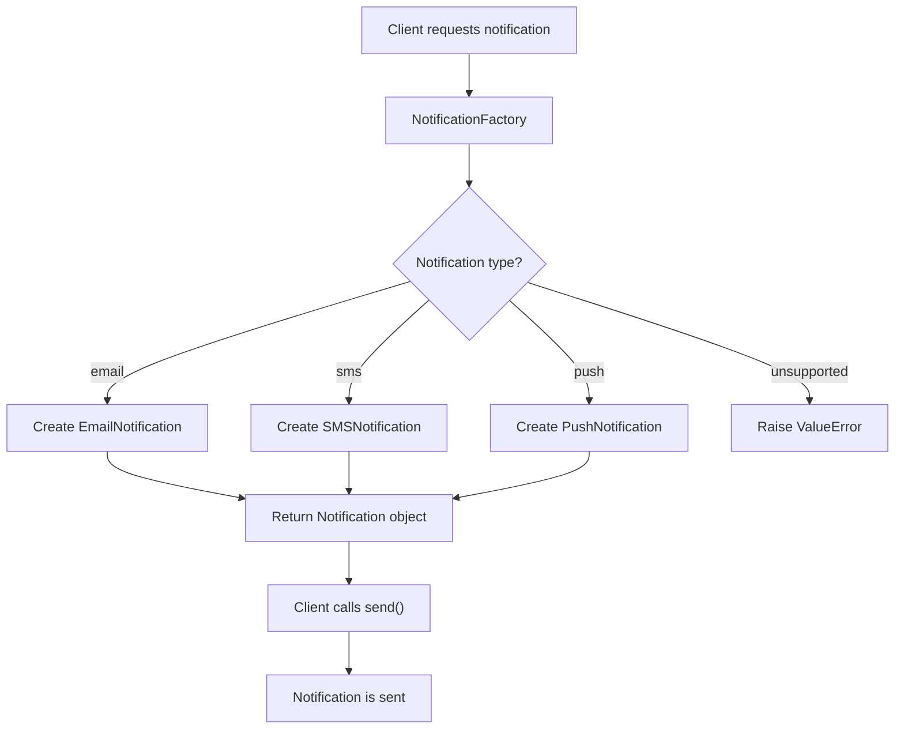
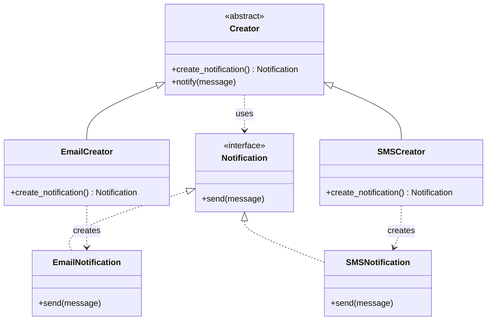

# Factory Pattern in Low-Level Design (LLD)

## 1. What Is the Factory Pattern?

The **Factory Pattern** is a creational design approach that encapsulates object creation logic and separates it from the code that uses the created objects.

Instead of directly creating concrete objects throughout the application, client code asks a factory to create the appropriate object.

This reduces coupling between the client and concrete implementations, making the system easier to extend and maintain.

> **Terminology:** Simple Factory is a common object-creation idiom. Factory Method is a formal Gang of Four (GoF) design pattern. This note focuses on the Simple Factory approach first, then explains Factory Method.

---

## 2. Why Do We Need the Factory Pattern?

Imagine a notification system that supports Email, SMS, and Push notifications.

Without a factory, the client must know which concrete class to instantiate.

```python
if notification_type == "email":
    notification = EmailNotification()
elif notification_type == "sms":
    notification = SMSNotification()
elif notification_type == "push":
    notification = PushNotification()
```

If object creation logic appears in multiple places, adding a new notification type can require modifying many parts of the application.

With a factory, the client delegates object creation to one component.

```python
notification = NotificationFactory.create("email")
notification.send("Your order has shipped!")
```

The client uses the returned object without needing to construct its concrete class directly.

### Benefits

- Centralizes object creation logic.
- Reduces coupling between client code and concrete classes.
- Makes object creation easier to maintain.
- Supports polymorphism.
- Can make it easier to add new implementations.

---

## 3. Factory Pattern — Class Diagram



### Diagram Explanation

- **Client:** Requests an object from the factory.
- **NotificationFactory:** Decides which concrete notification object to create.
- **Notification:** Defines a common interface.
- **Concrete Notifications:** Implement the common interface with different behavior.

The client depends on the factory and the common interface rather than directly constructing every concrete implementation.

---

## 4. Simple Factory Implementation in Python

### Step 1: Define the Product Interface

```python
from abc import ABC, abstractmethod


class Notification(ABC):
    @abstractmethod
    def send(self, message: str) -> None:
        pass
```

The interface ensures that all notification implementations provide a `send()` method.

### Step 2: Create Concrete Products

```python
class EmailNotification(Notification):
    def send(self, message: str) -> None:
        print(f"Sending Email: {message}")


class SMSNotification(Notification):
    def send(self, message: str) -> None:
        print(f"Sending SMS: {message}")


class PushNotification(Notification):
    def send(self, message: str) -> None:
        print(f"Sending Push Notification: {message}")
```

Each class implements the same interface but provides its own behavior.

### Step 3: Create the Factory

```python
class NotificationFactory:
    @staticmethod
    def create_notification(notification_type: str) -> Notification:
        if notification_type == "email":
            return EmailNotification()

        elif notification_type == "sms":
            return SMSNotification()

        elif notification_type == "push":
            return PushNotification()

        else:
            raise ValueError(
                f"Unsupported notification type: {notification_type}"
            )
```

The factory contains the object creation logic.

### Step 4: Use the Factory

```python
class NotificationService:
    def __init__(self, notification: Notification):
        self.notification = notification

    def notify(self, message: str) -> None:
        self.notification.send(message)


notification = NotificationFactory.create_notification("email")

service = NotificationService(notification)
service.notify("Your order has shipped!")
```

Output:

```text
Sending Email: Your order has shipped!
```

### What Did We Achieve?

The `NotificationService` does not need to know how an email notification is constructed. It only needs an object that satisfies the `Notification` interface.

The factory separates construction from use, while dependency injection allows the service to receive its dependency from outside.

---

## 5. Factory Execution Flow



---

## 6. A More Extensible Factory Using a Registry

A conditional factory is simple, but it must be modified whenever a new notification type is added.

A registry-based factory stores creation functions in a dictionary.

```python
from typing import Callable


class NotificationFactory:
    _creators: dict[str, Callable[[], Notification]] = {}

    @classmethod
    def register(
        cls,
        notification_type: str,
        creator: Callable[[], Notification],
    ) -> None:
        cls._creators[notification_type] = creator

    @classmethod
    def create_notification(
        cls,
        notification_type: str,
    ) -> Notification:
        try:
            creator = cls._creators[notification_type]
        except KeyError:
            raise ValueError(
                f"Unsupported notification type: {notification_type}"
            ) from None

        return creator()


NotificationFactory.register("email", EmailNotification)
NotificationFactory.register("sms", SMSNotification)
NotificationFactory.register("push", PushNotification)

notification = NotificationFactory.create_notification("sms")
notification.send("Your OTP is 123456")
```

### Advantages of a Registry

- Creation logic can be extended through registration.
- The factory avoids a long conditional chain.
- It supports plugin-style architectures.

### Important Design Consideration

A registry does not automatically guarantee the Open/Closed Principle. If new types must still be registered by editing central application code, that registration process remains a modification point. A plugin or dependency-injection system can provide a more extensible registration mechanism.

---

## 7. Factory Method Pattern

Factory Method is a specific GoF creational design pattern. It defines a creation method in a creator abstraction and allows concrete creators to decide which product to instantiate.

Unlike the Simple Factory, which usually selects a class through a conditional or registry, Factory Method uses polymorphism in the creator hierarchy.

### Mermaid Class Diagram



### Python Example

```python
from abc import ABC, abstractmethod


class Notification(ABC):
    @abstractmethod
    def send(self, message: str) -> None:
        pass


class EmailNotification(Notification):
    def send(self, message: str) -> None:
        print(f"Email: {message}")


class SMSNotification(Notification):
    def send(self, message: str) -> None:
        print(f"SMS: {message}")


class NotificationCreator(ABC):
    @abstractmethod
    def create_notification(self) -> Notification:
        pass

    def notify(self, message: str) -> None:
        notification = self.create_notification()
        notification.send(message)


class EmailCreator(NotificationCreator):
    def create_notification(self) -> Notification:
        return EmailNotification()


class SMSCreator(NotificationCreator):
    def create_notification(self) -> Notification:
        return SMSNotification()


creator = EmailCreator()
creator.notify("Your order has shipped!")
```

The `notify()` workflow is implemented once in the base creator. Concrete creators customize which notification is constructed.

---

## 8. Simple Factory vs. Factory Method

| Feature | Simple Factory | Factory Method |
|---|---|---|
| Creation mechanism | Usually conditional logic or a registry | Overridden creation method |
| Main structure | A factory creates products | Creator subclasses create products |
| Inheritance required | No | Typically yes |
| Adding a product | Often requires changing the factory or registry configuration | Usually requires a new concrete creator and product |
| Complexity | Lower | Higher |
| Best suited for | Straightforward creation decisions | Extensible systems with varying creation behavior |

**Interview tip:** When someone says “Factory Pattern,” ask whether they mean Simple Factory or Factory Method. The terms are often used loosely.

---

## 9. Factory Pattern and SOLID Principles

| Principle | Connection |
|---|---|
| Single Responsibility Principle (SRP) | Separates object creation from business operations. |
| Open/Closed Principle (OCP) | Polymorphic creators or extensible registration can reduce modifications to existing code. |
| Liskov Substitution Principle (LSP) | Concrete products should honor the common product contract. |
| Interface Segregation Principle (ISP) | Product interfaces should contain only relevant operations. |
| Dependency Inversion Principle (DIP) | Clients can work with abstractions instead of concrete products. |

A factory can help apply SOLID principles, but a factory full of conditionals may still need modification whenever new types are introduced.

---

## 10. Advantages and Disadvantages

### Advantages

- Encapsulates object creation.
- Reduces direct dependencies on concrete products.
- Supports polymorphism and interchangeable implementations.
- Centralizes creation and validation logic.
- Can simplify testing by separating construction from use.

### Disadvantages

- Adds extra abstractions and classes.
- A simple factory may grow into a large conditional statement.
- A central factory can become a modification bottleneck.
- Factory Method can introduce unnecessary inheritance when creation is simple.
- The pattern does not automatically solve lifecycle management or dependency injection.

---

## 11. When Should You Use the Factory Pattern?

Use a factory when:

- The concrete object type depends on runtime input or configuration.
- Object creation involves validation or additional setup.
- Several parts of the application need consistent creation logic.
- Clients should not depend directly on concrete implementations.
- You expect new implementations to be added over time.

Avoid it when a simple constructor already expresses the design clearly and object creation is unlikely to change.

---

## 12. Common Interview Questions

### Q1. What problem does the Factory Pattern solve?

It encapsulates object creation and reduces coupling between client code and concrete implementations.

### Q2. Is Simple Factory a GoF design pattern?

No. It is a widely used idiom. Factory Method and Abstract Factory are among the original GoF creational patterns.

### Q3. What is the difference between Factory Method and Abstract Factory?

Factory Method delegates the creation of a product to a creator implementation. Abstract Factory provides an interface for creating families of related products.

### Q4. Does a factory always need to be a class?

No. A factory can be a function, a method, a class, or a registry, depending on the design.

### Q5. Can a factory improve testability?

Yes. It can centralize construction, while dependency injection allows tests to supply mock or fake implementations. A factory alone does not automatically make code testable.

### Q6. What is the relationship between Factory and Dependency Injection?

A factory creates objects. Dependency injection supplies dependencies to the components that need them. They can be used together.

---

## 13. Practice Exercises

### Beginner

- Create a Shape Factory that creates `Circle`, `Rectangle`, and `Triangle` objects.
- Create a Payment Factory that creates `CardPayment`, `UPIPayment`, and `WalletPayment`.
- Handle invalid object types with meaningful errors.

### Intermediate

- Refactor a conditional factory into a registry.
- Define an abstract product interface and multiple implementations.
- Write unit tests for each product and for invalid factory inputs.

### Advanced

- Implement Factory Method for different document exporters: PDF, CSV, and JSON.
- Create an Abstract Factory for compatible UI components.
- Compare Simple Factory, Factory Method, and Abstract Factory for the same application.
- Explain how each design affects coupling, extensibility, and testing.

---

## 14. Final Takeaways

- The Factory Pattern encapsulates object creation.
- Simple Factory centralizes creation decisions.
- Factory Method delegates creation to specialized creator implementations.
- Clients should work with product abstractions whenever appropriate.
- A factory can improve maintainability, testability, and extensibility.
- Use the simplest creation mechanism that meets the requirements.
- Do not confuse Simple Factory with the formal Factory Method pattern.
