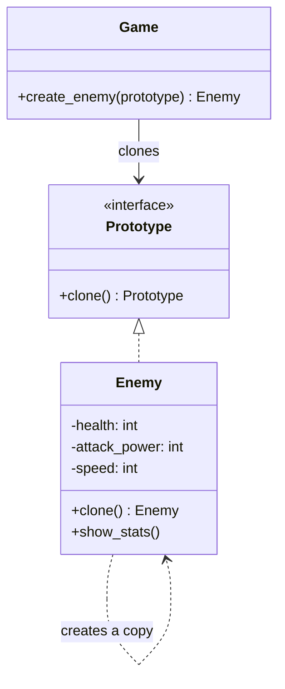
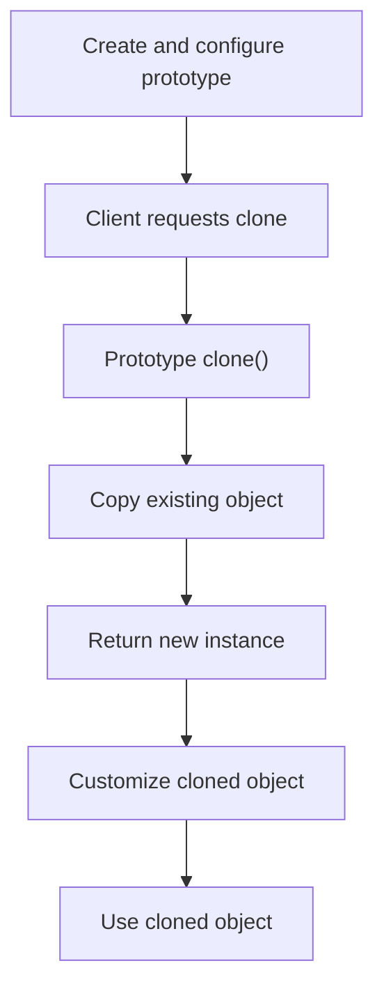
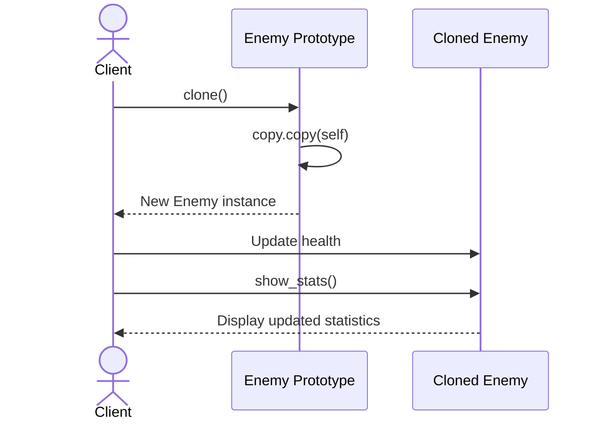
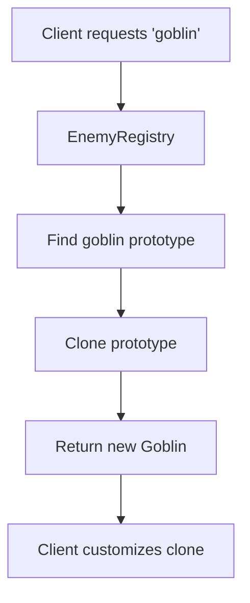

# Prototype Design Pattern

## 1. What Is the Prototype Design Pattern?

The **Prototype Design Pattern** is a creational design pattern that creates new objects by copying or cloning existing objects, known as prototypes, instead of constructing new objects from scratch.

It is useful when creating an object is expensive, complex, or requires many configuration steps.

Instead of repeatedly initializing the same kind of object, we create a prototype once and clone it whenever we need another instance.

### Real-World Example

Imagine you are developing a game with different enemy types.

Each enemy has:
- Health
- Attack power
- Movement speed
- Weapon
- Appearance

Creating and configuring every enemy from scratch can be repetitive.

With the Prototype Pattern, you create a configured enemy prototype and clone it whenever a new enemy is needed.

```python
enemy_prototype = Enemy(
    health=100,
    attack_power=20,
    speed=5,
)

enemy1 = enemy_prototype.clone()
enemy2 = enemy_prototype.clone()
```

Each clone starts with the prototype's configuration. You can then customize each clone independently, provided the cloning implementation handles mutable state correctly.

## 2. The Problem Without the Prototype Pattern

Consider creating multiple enemies with identical initial configurations:

```python
enemy1 = Enemy(100, 20, 5)
enemy2 = Enemy(100, 20, 5)
enemy3 = Enemy(100, 20, 5)
```

This approach can lead to:

- Repeated initialization logic.
- Duplicated configuration values.
- More complicated object creation when objects have many settings.
- Repeated expensive setup operations.
- Tight coupling between client code and concrete classes.

The Prototype Pattern lets the client request a copy of an existing configured object instead.

**Important:** Cloning is not automatically faster than construction. It is most useful when copying is simpler or cheaper than rebuilding the object, or when it simplifies configurable object creation.

## 3. Structure of the Prototype Pattern

| Component | Responsibility |
|---|---|
| Prototype | Defines a cloning operation |
| Concrete Prototype | Implements the cloning operation |
| Client | Requests a clone instead of constructing the object directly |

In Python, the prototype can define a `clone()` method that delegates to a copying mechanism such as `copy.copy()` or `copy.deepcopy()`.

## 4. UML Class Diagram



### Understanding the Diagram

- `Prototype` defines the cloning contract.
- `Enemy` implements the cloning behavior.
- `Game` depends on the prototype abstraction rather than constructing every enemy from scratch.
- A cloned enemy begins with the prototype's configured state.

## 5. Python Implementation Using `copy.copy()`

Python provides the built-in `copy` module for copying objects.

### Step 1: Import the Copy Module

```python
import copy
```

The module provides two commonly used functions:

| Function | Behavior |
|---|---|
| `copy.copy(obj)` | Creates a shallow copy |
| `copy.deepcopy(obj)` | Recursively copies nested objects where possible |

The difference between these two operations is important and is explained later.

### Step 2: Create the Prototype Class

```python
import copy


class Enemy:
    def __init__(
        self,
        health: int,
        attack_power: int,
        speed: int,
    ) -> None:
        self.health = health
        self.attack_power = attack_power
        self.speed = speed

    def clone(self) -> "Enemy":
        return copy.copy(self)

    def show_stats(self) -> None:
        print(f"Health: {self.health}")
        print(f"Attack Power: {self.attack_power}")
        print(f"Speed: {self.speed}")
```

### Explanation

**Constructor**

```python
def __init__(self, health, attack_power, speed):
```

Initializes an enemy with its configuration.

**Clone method**

```python
def clone(self) -> "Enemy":
    return copy.copy(self)
```

Creates a shallow copy of the existing enemy object.

The copied object is a separate instance, but nested mutable objects may still be shared between the original and the copy.

**Show statistics**

```python
def show_stats(self) -> None:
```

Displays the enemy's current configuration.

### Step 3: Create and Clone a Prototype

```python
# Create the prototype
enemy_prototype = Enemy(
    health=100,
    attack_power=20,
    speed=5,
)

# Clone the prototype
enemy1 = enemy_prototype.clone()
enemy2 = enemy_prototype.clone()

# Customize each clone
enemy1.health = 80
enemy2.attack_power = 30

print("Prototype:")
enemy_prototype.show_stats()

print("--- Enemy 1 ---")
enemy1.show_stats()

print("--- Enemy 2 ---")
enemy2.show_stats()
```

Output:

```text
Prototype:
Health: 100
Attack Power: 20
Speed: 5
--- Enemy 1 ---
Health: 80
Attack Power: 20
Speed: 5
--- Enemy 2 ---
Health: 100
Attack Power: 30
Speed: 5
```

Each clone has its own integer attributes. Changing an integer attribute on one object does not change that attribute on the other objects.

## 6. Prototype Pattern Execution Flow



The important distinction is that the client starts from an existing configured object instead of repeating all the original initialization steps.

## 7. Sequence Diagram



The clone operation returns a new object. The client can then modify and use that object independently, subject to the copy semantics.

## 8. Shallow Copy vs Deep Copy

Understanding this difference is essential when implementing the Prototype Pattern in Python.

Consider an object that contains a list:

```python
import copy


class Enemy:
    def __init__(self, name: str, weapons: list[str]) -> None:
        self.name = name
        self.weapons = weapons


prototype = Enemy(
    name="Goblin",
    weapons=["Sword", "Bow"],
)

shallow_clone = copy.copy(prototype)
deep_clone = copy.deepcopy(prototype)
```

### Shallow Copy

```python
shallow_clone = copy.copy(prototype)
```

A shallow copy creates a new outer object but keeps references to the same nested objects.

```python
shallow_clone.weapons.append("Axe")

print(prototype.weapons)
```

Output:

```text
['Sword', 'Bow', 'Axe']
```

The prototype's list also changes because both objects refer to the same list.

### Deep Copy

```python
deep_clone = copy.deepcopy(prototype)
```

A deep copy recursively copies nested objects where possible.

```python
deep_clone.weapons.append("Dagger")

print(prototype.weapons)
print(deep_clone.weapons)
```

Output:

```text
['Sword', 'Bow']
['Sword', 'Bow', 'Dagger']
```

The lists are independent in this example.

### Comparison

| Feature | Shallow Copy | Deep Copy |
|---|---|---|
| Creates a new outer object | Yes | Yes |
| Copies nested objects recursively | No | Usually, where supported |
| Shares nested mutable objects | Often | Usually avoids sharing copied nested objects |
| Performance and memory cost | Generally lower | Generally higher |
| Best suited for | Objects with safe-to-share references | Objects that need independent nested mutable state |

**Important:** Deep copying is not always appropriate. Some objects contain resources such as file handles, database connections, locks, or other state that should not be duplicated. Custom copying logic may be necessary.

## 9. Prototype Registry

Sometimes an application needs several kinds of prototypes, such as different enemy types.

A **Prototype Registry** stores configured prototypes by name and returns clones when requested.

### Example

```python
import copy


class Enemy:
    def __init__(
        self,
        name: str,
        health: int,
        attack_power: int,
    ) -> None:
        self.name = name
        self.health = health
        self.attack_power = attack_power

    def clone(self) -> "Enemy":
        return copy.deepcopy(self)


class EnemyRegistry:
    def __init__(self) -> None:
        self._prototypes: dict[str, Enemy] = {}

    def register(self, name: str, prototype: Enemy) -> None:
        self._prototypes[name] = prototype

    def create(self, name: str) -> Enemy:
        try:
            prototype = self._prototypes[name]
        except KeyError:
            raise ValueError(
                f"Unknown enemy prototype: {name}"
            ) from None

        return prototype.clone()
```

### Register and Use Prototypes

```python
registry = EnemyRegistry()

registry.register(
    "goblin",
    Enemy("Goblin", health=50, attack_power=10),
)

registry.register(
    "boss",
    Enemy("Dragon Boss", health=500, attack_power=80),
)

goblin1 = registry.create("goblin")
goblin2 = registry.create("goblin")
boss = registry.create("boss")

goblin1.health = 25

print(goblin1.health)  # 25
print(goblin2.health)  # 50
print(boss.health)     # 500
```

### Registry Diagram



The registry makes it easy to add new predefined configurations without placing all the creation logic inside the client.

## 10. Prototype Pattern vs Factory Pattern

Both patterns are creational, but they differ in how objects are obtained.

| Feature | Prototype Pattern | Factory Pattern |
|---|---|---|
| Main idea | Copy an existing configured object | Encapsulate the creation of an object |
| Creation mechanism | Cloning | Constructor calls or creator methods |
| Existing prototype required | Usually yes | No |
| Useful when | Objects have complex existing configurations | The correct product type must be selected |
| Typical example | Clone a configured game enemy | Select an email or SMS notification |

### Factory Example

```python
notification = NotificationFactory.create_notification("sms")
```

The factory looks up a creator and constructs the requested notification.

### Prototype Example

```python
enemy = enemy_prototype.clone()
```

The prototype creates a new object by copying an existing configured object.

**Remember:**

- Factory Pattern → Create an object through a creation mechanism.
- Prototype Pattern → Create an object by cloning an existing object.

These patterns can also be combined. A factory or registry can select a prototype and clone it.

## 11. Prototype Pattern vs Builder Pattern

| Feature | Prototype Pattern | Builder Pattern |
|---|---|---|
| Main idea | Clone an existing object | Construct an object step by step |
| Starting point | An existing prototype | A builder and its configuration |
| Configuration | Inherited from the prototype, then customized | Collected through construction steps |
| Useful when | Many objects share a common starting configuration | Objects require complex or staged construction |

Example:

```python
# Prototype
new_enemy = enemy_prototype.clone()

# Builder
computer = (
    ComputerBuilder()
    .set_cpu("Intel Core i7")
    .set_ram(32)
    .build()
)
```

Prototype begins with an existing object. Builder assembles an object through explicit construction steps.

## 12. Advantages

- **Reduced repeated setup:** Reuse an existing configuration.
- **Flexible object creation:** Clone an object and customize the result.
- **Reduced coupling:** Clients can work with a prototype abstraction.
- **Convenient configuration reuse:** A registry can store predefined prototypes.
- **Useful for dynamic configurations:** New prototypes can be registered at runtime.
- **Can simplify complex initialization:** Especially when copying is easier than repeating the setup process.

## 13. Disadvantages

- **Copying can be complex:** Nested objects and shared references need careful handling.
- **Deep copying can be expensive:** It may use additional time and memory.
- **Some objects cannot be copied safely:** External resources may require custom behavior.
- **Clone behavior can be unclear:** Developers must understand whether a clone is shallow or deep.
- **Configuration can become harder to maintain:** Many prototypes may require a registry or configuration strategy.
- **Not always faster:** For simple objects, ordinary construction may be clearer and more efficient.

## 14. When Should You Use the Prototype Pattern?

Use the Prototype Pattern when:

1. Creating a configured object repeatedly involves expensive setup.
2. Many objects share a common starting configuration.
3. You need to create variations of an existing object.
4. The concrete object types or configurations are selected dynamically.
5. A registry of predefined templates would simplify client code.

### Real-World Use Cases

- **Game development:** Cloning enemies, weapons, NPCs, and level objects.
- **Document editors:** Duplicating configured document templates.
- **UI systems:** Creating components from predefined styles.
- **Configuration management:** Cloning baseline configurations before customizing them.
- **Simulation software:** Creating variations of existing entities.
- **Design applications:** Duplicating configured shapes or visual objects.

## 15. Relationship with SOLID Principles

### Single Responsibility Principle (SRP)

Cloning behavior can be kept within the prototype, while the client handles how the clone is used.

### Open/Closed Principle (OCP)

New prototype types can be introduced without rewriting the client, provided the client uses a common prototype interface or compatible cloning contract.

### Liskov Substitution Principle (LSP)

Concrete prototypes should preserve the expected behavior of the prototype abstraction, including the semantics promised by `clone()`.

### Dependency Inversion Principle (DIP)

Client code can depend on a prototype interface rather than concrete classes when the design defines a suitable abstraction.

The Prototype Pattern does not automatically guarantee SOLID compliance. Copying behavior and object ownership still need to be designed carefully.

## 16. Common Mistakes

### Mistake 1: Returning the Same Object

Incorrect:

```python
def clone(self):
    return self
```

This returns the original object, not a clone.

Correct:

```python
def clone(self):
    return copy.copy(self)
```

Or use `copy.deepcopy(self)` if independent nested state is required and deep copying is appropriate.

### Mistake 2: Ignoring Mutable Attributes

A shallow copy may share lists, dictionaries, or other nested mutable objects with the original.

Choose the copying strategy based on which parts of the object should be shared and which must be independent.

### Mistake 3: Assuming Deep Copy Works for Every Object

Deep copying does not guarantee that every resource is independently duplicated. Objects involving external resources may require custom `__copy__()` or `__deepcopy__()` methods, or a different cloning approach.

### Mistake 4: Using Prototype for Simple Objects

If an object is easy to construct and has few settings, a normal constructor may be simpler than implementing cloning behavior.

## 17. Interview Questions

### Q1. What is the Prototype Design Pattern?

A creational pattern that creates new objects by cloning existing configured objects.

### Q2. Why use Prototype instead of a constructor?

Prototype can simplify repeated creation when objects have expensive initialization or reusable configurations.

### Q3. What is the difference between shallow and deep copying?

A shallow copy creates a new outer object but may share nested objects. A deep copy recursively copies nested objects where possible.

### Q4. What is a Prototype Registry?

A registry stores named prototypes and allows clients to request clones by name.

### Q5. Does Prototype eliminate constructors?

No. The original prototype must usually be constructed somehow, and cloning may still invoke class-specific copying behavior.

### Q6. Can Prototype and Factory be used together?

Yes. A factory or registry can select a stored prototype and return a clone of it.

### Q7. Is cloning always more efficient than creating a new object?

No. It depends on the cost of initialization, copying, and managing nested state.

### Q8. How does Python implement the Prototype Pattern?

Python can use `copy.copy()`, `copy.deepcopy()`, or custom `clone()` methods that define the required copying behavior.

## 18. Practice Exercises

1. Create a `GameCharacter` class with health, strength, inventory, and skills.
2. Implement a `clone()` method using shallow copying.
3. Change the implementation to deep copying and test whether inventory changes affect the original.
4. Build a `CharacterRegistry` that stores warrior, mage, and archer prototypes.
5. Add validation to prevent unknown prototype names.
6. Create a `DocumentTemplate` class that clones documents with predefined formatting.
7. Write unit tests that verify clones are distinct objects and that mutable attributes have the intended sharing behavior.

## 19. Key Takeaways

- Prototype is a **creational design pattern**.
- It creates new objects by copying existing configured objects.
- A `clone()` method defines how a prototype is copied.
- Python provides `copy.copy()` and `copy.deepcopy()`.
- Shallow copying can share nested mutable state; deep copying usually duplicates nested state where supported.
- A Prototype Registry stores prototypes for convenient lookup and cloning.
- Prototype is useful when reusing configurations simplifies object creation.
- Cloning should be designed carefully when objects contain mutable data or external resources.
