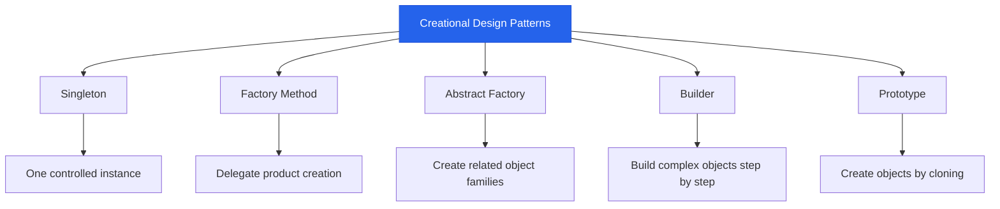

# Creational Design Patterns in Low-Level Design (LLD)

## 1. What Are Creational Design Patterns?

**Creational Design Patterns** are design patterns that deal with the process of creating objects. They provide flexible and controlled ways to instantiate objects without tightly coupling the code to specific concrete classes.

Instead of creating objects directly everywhere using constructors, creational patterns encapsulate or delegate object creation.

### Why Do We Need Creational Design Patterns?

In a simple application, creating objects directly may be sufficient.

```python
payment = CreditCardPayment()
```

However, as an application grows, object creation can become complex. The application might need to choose different implementations, build complex objects step by step, or reuse existing objects.

Creational design patterns help us:

- Reduce coupling between client code and concrete classes.
- Encapsulate complex object creation logic.
- Make object creation easier to modify and extend.
- Control how and when objects are created.
- Improve testability and maintainability.
- Support flexible object creation based on runtime conditions.

---

## 2. Types of Creational Design Patterns

There are five commonly recognized creational design patterns in the GoF (Gang of Four) design pattern catalog.

| Pattern | Main Purpose | Example |
|---|---|---|
| Singleton | Ensure a class has only one instance and provide a shared access point | Application configuration |
| Factory Method | Let subclasses or implementations decide which concrete product to create | Notification creator |
| Abstract Factory | Create families of related objects without specifying their concrete classes | Cross-platform UI components |
| Builder | Construct complex objects step by step | Computer configuration |
| Prototype | Create new objects by copying existing prototypes | Cloning game characters |

> **Note:** Simple Factory is a commonly used object-creation idiom, but it is not one of the original five GoF design patterns.

---

## 3. Creational Design Patterns Overview



---

## 4. Singleton Pattern

### Definition

The Singleton Pattern ensures that a class has only one instance and provides a globally accessible way to obtain that instance.

### Example Use Cases

- Application configuration
- Shared logging service
- A process-wide registry
- A shared in-memory cache

### Basic Python Example

```python
class Singleton:
    _instance = None

    def __new__(cls):
        if cls._instance is None:
            cls._instance = super().__new__(cls)
        return cls._instance


first = Singleton()
second = Singleton()

print(first is second)  # True
```

### Key Idea

Multiple requests for an instance return the same object.

### Advantages

- Controls the number of instances.
- Provides a shared access point.
- Can avoid unnecessary duplicate instances.

### Disadvantages

- Global access can introduce hidden dependencies.
- Can make unit testing harder.
- Requires extra care with concurrency and initialization.

**Remember:** Singleton is about controlling the number of instances, not merely storing an object in a global variable.

---

## 5. Factory Method Pattern

### Definition

The Factory Method Pattern defines an interface for creating an object while allowing subclasses or concrete creators to determine which concrete product is instantiated.

It separates the code that uses a product from the code that decides which product to create.

### Example Use Case

A notification system supports email and SMS notifications.

### Python Example

```python
from abc import ABC, abstractmethod


class Notification(ABC):
    @abstractmethod
    def send(self, message):
        pass


class EmailNotification(Notification):
    def send(self, message):
        print(f"Email: {message}")


class SMSNotification(Notification):
    def send(self, message):
        print(f"SMS: {message}")


class NotificationCreator(ABC):
    @abstractmethod
    def create_notification(self):
        pass

    def notify(self, message):
        notification = self.create_notification()
        notification.send(message)


class EmailCreator(NotificationCreator):
    def create_notification(self):
        return EmailNotification()


class SMSCreator(NotificationCreator):
    def create_notification(self):
        return SMSNotification()


creator = EmailCreator()
creator.notify("Your order has been shipped.")
```

### Key Idea

The creator delegates product creation to a specialized implementation.

### Advantages

- Reduces direct coupling to concrete products.
- Supports adding new product types.
- Makes creation decisions easier to customize.

### Disadvantages

- May introduce additional classes.
- Can be unnecessary when object creation is simple and unlikely to change.

**Remember:** Factory Method delegates the decision about which product to instantiate.

---

## 6. Abstract Factory Pattern

### Definition

The Abstract Factory Pattern provides an interface for creating families of related or compatible objects without specifying their concrete classes.

### Example Use Case

A cross-platform application needs buttons and checkboxes for different operating systems.

- Windows factory creates Windows-style components.
- macOS factory creates macOS-style components.

### Conceptual Example

```python
from abc import ABC, abstractmethod


class Button(ABC):
    @abstractmethod
    def render(self):
        pass


class Checkbox(ABC):
    @abstractmethod
    def render(self):
        pass


class WindowsButton(Button):
    def render(self):
        print("Windows button")


class WindowsCheckbox(Checkbox):
    def render(self):
        print("Windows checkbox")


class GUIFactory(ABC):
    @abstractmethod
    def create_button(self):
        pass

    @abstractmethod
    def create_checkbox(self):
        pass


class WindowsFactory(GUIFactory):
    def create_button(self):
        return WindowsButton()

    def create_checkbox(self):
        return WindowsCheckbox()
```

### Key Idea

A factory creates a compatible family of products.

### Advantages

- Keeps related products consistent.
- Separates product creation from application logic.
- Supports multiple product families.

### Disadvantages

- Adding a new product family is straightforward, but adding a new product type to every family can require changes across factories.
- Can introduce many interfaces and concrete classes.

**Remember:** Abstract Factory focuses on creating families of related objects.

---

## 7. Builder Pattern

### Definition

The Builder Pattern separates the construction of a complex object from its representation, allowing the same construction process to produce different configurations.

It is especially useful when an object has many optional parameters or multiple construction steps.

### Example Use Case

Building a computer with configurable components:

- CPU
- RAM
- Storage
- Graphics card
- Operating system

### Python Example

```python
class Computer:
    def __init__(self):
        self.cpu = None
        self.ram = None
        self.storage = None

    def __str__(self):
        return (
            f"Computer(CPU={self.cpu}, "
            f"RAM={self.ram}, Storage={self.storage})"
        )


class ComputerBuilder:
    def __init__(self):
        self.computer = Computer()

    def set_cpu(self, cpu):
        self.computer.cpu = cpu
        return self

    def set_ram(self, ram):
        self.computer.ram = ram
        return self

    def set_storage(self, storage):
        self.computer.storage = storage
        return self

    def build(self):
        return self.computer


computer = (
    ComputerBuilder()
    .set_cpu("Intel Core i7")
    .set_ram("32 GB")
    .set_storage("1 TB SSD")
    .build()
)

print(computer)
```

### Key Idea

Construct an object through a sequence of explicit configuration steps.

### Advantages

- Improves readability when many parameters are optional.
- Supports different configurations.
- Separates construction logic from the final object.

### Disadvantages

- Adds complexity for simple objects.
- May require additional builder classes.

**Remember:** Builder is useful when an object needs controlled, step-by-step construction.

---

## 8. Prototype Pattern

### Definition

The Prototype Pattern creates new objects by copying an existing object, called a prototype, rather than constructing every object from scratch.

### Example Use Case

A game contains many enemy characters with similar initial configurations. A prototype can be copied and customized for each new enemy.

### Python Example

```python
from copy import deepcopy


class Enemy:
    def __init__(self, name, health, abilities):
        self.name = name
        self.health = health
        self.abilities = abilities


prototype = Enemy(
    "Goblin",
    100,
    ["Attack", "Dodge"]
)

enemy1 = deepcopy(prototype)
enemy1.name = "Goblin 1"

enemy2 = deepcopy(prototype)
enemy2.name = "Goblin 2"

print(enemy1.name)
print(enemy2.name)
```

### Key Idea

Create objects by copying an existing object's state.

### Advantages

- Can avoid repeating complex initialization.
- Makes it easy to create variations of an existing object.
- Useful when initial objects are expensive to construct.

### Disadvantages

- Shallow versus deep copying must be considered.
- Objects with external resources may need custom cloning logic.
- Cloning behavior can become complicated for interconnected objects.

**Remember:** Prototype creates objects by cloning existing instances.

---

## 9. Comparison of Creational Design Patterns

| Pattern | Main Question It Answers |
|---|---|
| Singleton | How can I ensure only one instance exists? |
| Factory Method | Which concrete product should be created? |
| Abstract Factory | Which family of related products should be created? |
| Builder | How should a complex object be constructed step by step? |
| Prototype | Can I create a new object by copying an existing one? |

### Factory Method vs. Abstract Factory

- **Factory Method:** Delegates creation of a product to a creator implementation.
- **Abstract Factory:** Provides methods for creating multiple related product types.

### Builder vs. Factory

- **Factory:** Focuses primarily on deciding which object to create.
- **Builder:** Focuses on constructing and configuring an object through multiple steps.

### Prototype vs. Builder

- **Prototype:** Copies an existing object's state.
- **Builder:** Constructs an object through explicit steps.

### Singleton vs. Factory

- **Singleton:** Controls instance uniqueness and access.
- **Factory:** Encapsulates object creation decisions.

These patterns solve different problems and can sometimes be combined.

---

## 10. When Should You Use Creational Design Patterns?

Use a creational pattern when it solves a real object-creation problem.

Ask yourself:

1. Does the application need to control how many instances exist?
2. Does the code need to choose among multiple concrete implementations?
3. Must related objects be created as a compatible family?
4. Is an object complex to construct or configured through many steps?
5. Would copying an existing object be simpler than recreating it?

If object creation is straightforward, a normal constructor is often the clearest choice.

Avoid adding a design pattern just because it is available.

---

## 11. Relationship Between Creational Patterns and SOLID

| SOLID Principle | Connection |
|---|---|
| Single Responsibility Principle (SRP) | Separating object creation from business logic can give classes clearer responsibilities. |
| Open/Closed Principle (OCP) | Factories and polymorphism can make it easier to introduce new implementations. |
| Liskov Substitution Principle (LSP) | Concrete products should respect the contracts expected by their clients. |
| Interface Segregation Principle (ISP) | Keep factory and product interfaces focused on relevant operations. |
| Dependency Inversion Principle (DIP) | Clients should depend on abstractions rather than unnecessary concrete implementations. |

Creational patterns can support SOLID, but using a pattern does not automatically guarantee good design.

---

## 12. Practice Exercises

### Beginner

- Implement a Singleton configuration manager.
- Create a Factory Method for email, SMS, and push notifications.
- Build a configurable Computer using Builder.

### Intermediate

- Design an Abstract Factory for Windows and macOS UI components.
- Implement Prototype cloning for game characters with nested inventory objects.
- Write unit tests for each pattern.

### Advanced

- Design a notification platform supporting multiple providers.
- Allow new notification providers without changing the notification workflow.
- Add failure handling and retry policies.
- Compare a direct-construction implementation with a pattern-based implementation.
- Explain the trade-offs, extra classes, and coupling in each design.

---

## 13. Final Takeaways

- Creational patterns focus on object creation.
- Singleton controls instance uniqueness.
- Factory Method delegates product creation.
- Abstract Factory creates families of related objects.
- Builder constructs complex objects step by step.
- Prototype creates objects by copying existing prototypes.
- Choose patterns based on changing requirements and construction complexity.
- Keep simple object creation simple.
- Prefer clear responsibilities and abstractions over unnecessary design-pattern usage.
