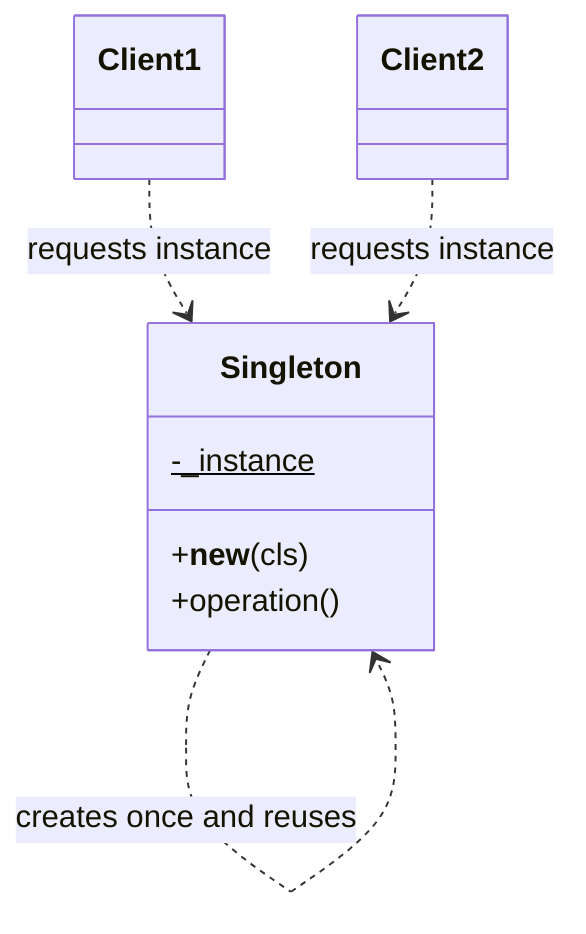
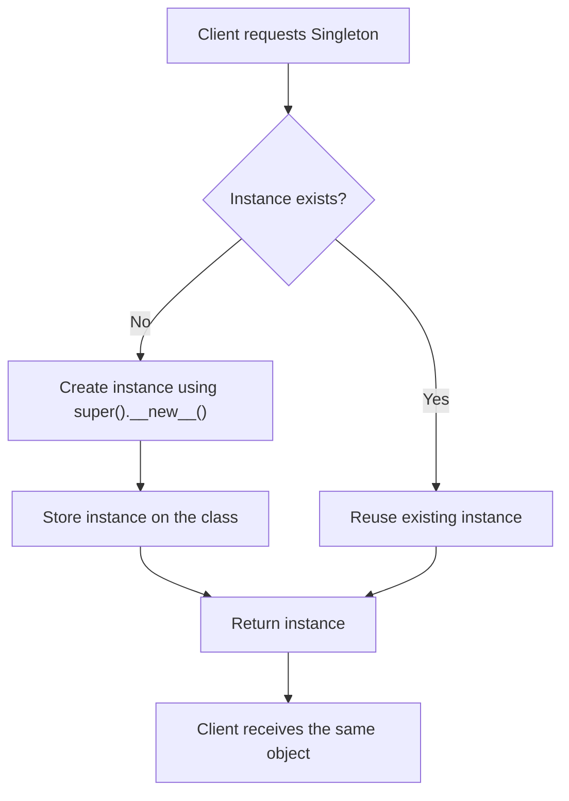
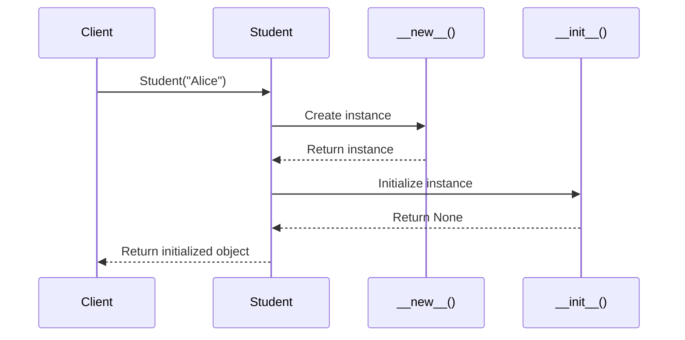

# Singleton Pattern in Low-Level Design (LLD)

## 1. What Is the Singleton Pattern?

The **Singleton Pattern** is a creational design pattern that ensures a class has only one instance and provides a single, globally accessible point to obtain that instance.

Instead of creating multiple objects of the same class, every request for the Singleton returns the same instance.

### Real-World Examples

- **Configuration Manager:** Maintains shared application settings.
- **Logger:** Provides a shared logging interface.
- **Database Connection Manager:** Coordinates access to a shared connection resource.
- **Cache Manager:** Provides access to a shared in-memory cache.

> **Note:** A Singleton is not always the best solution for these use cases. Dependency injection and explicitly shared instances can be easier to test and maintain.

---

## 2. Why Do We Need the Singleton Pattern?

Consider a class that manages application configuration.

Without Singleton:

```python
class Configuration:
    def __init__(self):
        self.settings = {"theme": "dark"}


config1 = Configuration()
config2 = Configuration()

print(config1 is config2)  # False
```

Each constructor call creates a separate object with its own state.

With Singleton, both references point to the same object.

```python
config1 = Configuration()
config2 = Configuration()

print(config1 is config2)  # True, if Configuration implements Singleton
```

### Problems Singleton Can Solve

- Preventing duplicate instances of a resource manager.
- Maintaining one shared instance within a defined scope.
- Centralizing access to shared state.
- Avoiding repeated initialization when a single instance is appropriate.

---

## 3. How Does the Singleton Pattern Work?

The Singleton implementation commonly uses these steps:

1. Store a reference to the instance on the class.
2. Check whether an instance already exists.
3. Create an instance only if one does not exist.
4. Return the existing instance on subsequent requests.

### Mermaid Class Diagram



### Object Creation Flowchart



---

## 4. Singleton Implementation in Python

### Method 1: Using `__new__()`

Python's `__new__()` method is responsible for creating and returning an instance.

```python
class Singleton:
    _instance = None

    def __new__(cls):
        if cls._instance is None:
            cls._instance = super().__new__(cls)

        return cls._instance


first = Singleton()
second = Singleton()

print(first is second)  # True
print(id(first) == id(second))  # True
```

### How It Works

**Step 1:** The first call to `Singleton()` invokes `Singleton.__new__()`.

**Step 2:** `_instance` is `None`, so a new object is created using `super().__new__(cls)`.

**Step 3:** The new object is stored in `cls._instance`.

**Step 4:** The second call finds the existing instance and returns it.

**Step 5:** Both variables reference the same object.

### Important Detail

Python calls `__init__()` after `__new__()` returns an instance of the class. Therefore, in this implementation, `__init__()` would execute on every `Singleton()` call if the class defines it.

This matters when initialization changes state or performs expensive operations.

---

## 5. Difference Between `__new__()` and `__init__()` in Python

Both are special methods involved in object construction, but they have different responsibilities.

| Feature | `__new__()` | `__init__()` |
|---|---|---|
| Purpose | Creates and returns an instance | Initializes an already-created instance |
| Execution | Called before `__init__()` | Called after `__new__()` returns an instance of the class |
| First parameter | Usually `cls` | Usually `self` |
| Receives | The class being instantiated | The created instance |
| Return value | Returns an instance, usually using `super().__new__(cls)` | Must return `None` |
| Typical use | Customizing instance creation, immutable types, Singleton implementations | Assigning attributes and initializing object state |
| Frequency | In ordinary construction, called for each construction request | Normally called after each successful `__new__()` result of the requested type |
| Can control object creation? | Yes | No; it initializes the object returned by `__new__()` |

### Example: `__new__()` and `__init__()` Together

```python
class Student:
    def __new__(cls, name):
        print("__new__: Creating object")
        instance = super().__new__(cls)
        return instance

    def __init__(self, name):
        print("__init__: Initializing object")
        self.name = name


student = Student("Alice")
```

Output:

```text
__new__: Creating object
__init__: Initializing object
```

### Object Creation Sequence



### Easy Way to Remember

- `__new__()` = **Create the object.**
- `__init__()` = **Initialize the object.**

Think of creating a house:

- `__new__()` provides the house structure.
- `__init__()` configures the rooms, furniture, and other initial properties.

Technically, `__init__()` does not construct the object itself. It initializes the instance that has already been created.

---

## 6. Why Is `__new__()` Useful for Singleton?

A normal constructor call such as `Singleton()` can create a new object each time. Overriding `__new__()` allows the class to control which instance is returned.

Consider this example:

```python
class Singleton:
    _instance = None

    def __new__(cls):
        if cls._instance is None:
            print("Creating instance")
            cls._instance = super().__new__(cls)
        else:
            print("Reusing instance")

        return cls._instance


a = Singleton()
b = Singleton()
c = Singleton()

print(a is b)  # True
print(b is c)  # True
```

Output:

```text
Creating instance
Reusing instance
Reusing instance
True
True
```

The `__new__()` method controls instance creation, so subsequent calls reuse the stored object.

---

## 7. A Safer Singleton with `__init__()`

The previous implementation has a subtle problem: `__init__()` runs on every constructor call. We can guard against reinitialization.

```python
class Singleton:
    _instance = None

    def __new__(cls):
        if cls._instance is None:
            cls._instance = super().__new__(cls)

        return cls._instance

    def __init__(self):
        if getattr(self, "_initialized", False):
            return

        self.settings = {}
        self._initialized = True


first = Singleton()
first.settings["theme"] = "dark"

second = Singleton()

print(first is second)  # True
print(second.settings)  # {'theme': 'dark'}
```

The `_initialized` flag prevents the shared object's settings from being reset on subsequent calls.

**Important:** This simple version is not inherently thread-safe. Concurrent calls can race during instance creation or initialization. Production implementations need to consider synchronization and the desired scope of the Singleton.

---

## 8. Singleton with a Class Method

Another approach is to make instance access explicit using a class method.

```python
class Configuration:
    _instance = None

    @classmethod
    def get_instance(cls):
        if cls._instance is None:
            cls._instance = cls()

        return cls._instance


config1 = Configuration.get_instance()
config2 = Configuration.get_instance()

print(config1 is config2)  # True
```

This is a simple access-point pattern, but it does not strictly enforce Singleton because callers can still use `Configuration()` directly and create additional objects.

To enforce uniqueness, the constructor path must also be controlled.

---

## 9. Advantages of Singleton

- **Controlled instance creation:** Limits instances when uniqueness is genuinely required.
- **Shared state:** Multiple consumers can access the same in-memory state.
- **Centralized access:** Provides one known access point.
- **Lazy initialization:** The instance can be created only when first requested.

## 10. Disadvantages of Singleton

- **Global state:** Dependencies can become hidden.
- **Testing difficulties:** Tests may share state unexpectedly.
- **Concurrency concerns:** Simultaneous initialization requires care.
- **Tight coupling:** Classes may depend directly on a concrete Singleton.
- **Lifecycle concerns:** Resetting or replacing the instance can be difficult.
- **Inheritance complications:** Subclasses may accidentally share or create separate instances, depending on implementation.

---

## 11. Singleton and SOLID Principles

| Principle | Relationship |
|---|---|
| SRP | A Singleton can mix business responsibilities with instance-management responsibilities. |
| OCP | Extending a Singleton can be difficult if creation logic is rigid. |
| LSP | Subclasses must preserve expected behavior and instance semantics. |
| ISP | Consumers should depend only on the operations they need. |
| DIP | Depending on a concrete global Singleton can violate the spirit of depending on abstractions. |

Singleton does not automatically violate SOLID, but it can make clean separation of responsibilities and dependency management harder.

---

## 12. Singleton vs. Other Creational Patterns

| Pattern | Main Purpose |
|---|---|
| Singleton | Ensure one instance within the intended scope |
| Factory Method | Delegate which product gets created |
| Abstract Factory | Create families of related objects |
| Builder | Construct complex objects step by step |
| Prototype | Create objects by copying existing instances |

A Singleton controls **how many instances** exist, while Factory Method controls **which product** gets created.

---

## 13. Common Interview Questions

### Q1. What is the Singleton Pattern?

A creational design pattern that ensures a class has only one instance and provides a shared access point to it.

### Q2. Why use `__new__()` instead of `__init__()`?

`__new__()` controls instance creation and can return an existing instance. `__init__()` only initializes the instance returned by `__new__()`.

### Q3. Does `__init__()` run every time a Singleton is requested?

Yes, in the basic implementation shown here, it runs on every construction call because `__new__()` returns an instance of the class each time. Guard initialization if necessary.

### Q4. Is a Singleton automatically thread-safe in Python?

No. Concurrent calls can race during creation or initialization unless synchronization or another suitable design is used.

### Q5. Is Singleton always a good design choice?

No. Dependency injection or explicitly sharing an instance can provide similar behavior with fewer testing and coupling problems.

### Q6. Can a Singleton be implemented without `__new__()`?

Yes. A class method or a module-level instance can provide a shared instance, although the class-method approach alone does not prevent direct construction.

### Q7. What does `super().__new__(cls)` do?

It delegates object allocation to the parent implementation of `__new__()`, which normally creates an uninitialized instance of the requested class.

---

## 14. Practice Exercises

### Beginner

- Implement a Singleton `Logger`.
- Verify that two references point to the same object.
- Add an attribute and confirm that both references see the same state.

### Intermediate

- Implement a configuration manager that loads settings only once.
- Prevent `__init__()` from resetting existing state.
- Write unit tests for object identity and initialization.

### Advanced

- Make instance creation thread-safe.
- Test how subclassing affects instance uniqueness.
- Compare Singleton with dependency injection.
- Design a shared cache and explain whether Singleton is actually necessary.

---

## 15. Final Takeaways

- Singleton is a creational design pattern.
- It controls instance creation and provides a shared access point.
- `__new__()` creates and returns the instance.
- `__init__()` initializes the returned instance.
- In a basic Singleton implemented through `__new__()`, `__init__()` can run multiple times.
- Protect initialization when repeated initialization would be harmful.
- Consider thread safety, testing, inheritance, and object lifecycle.
- Prefer Singleton only when a single shared instance is a genuine requirement.
